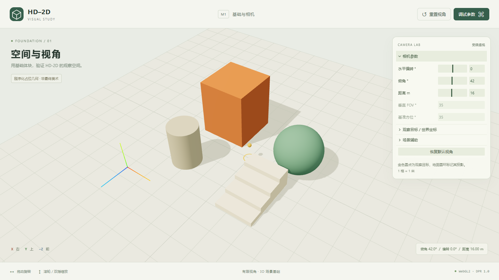
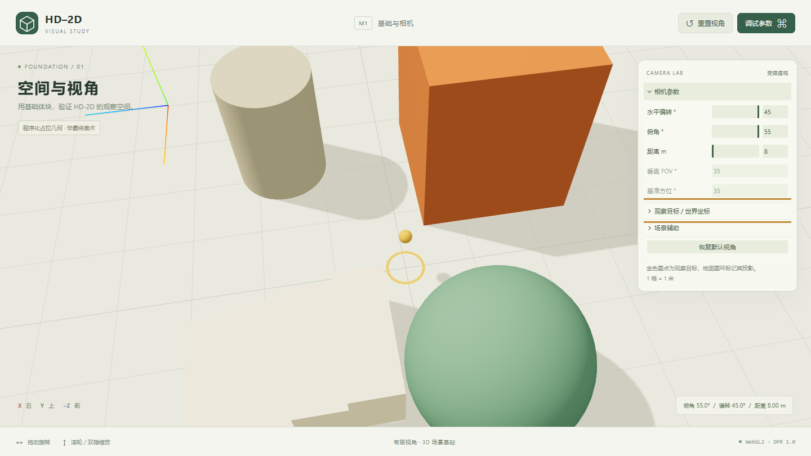
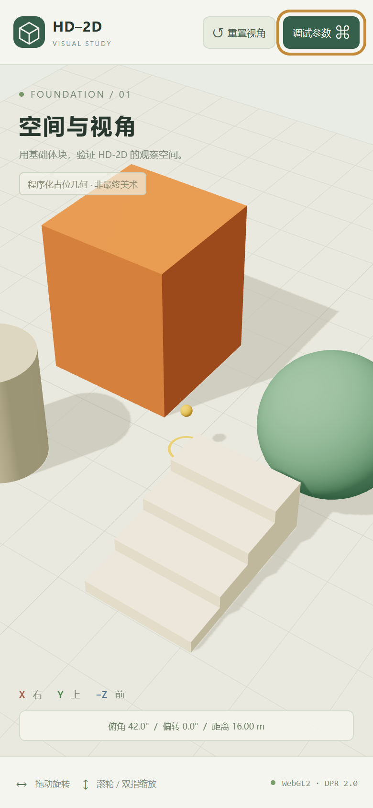

# M1 handoff — 2026-10-28

M1 已完成：可运行的 Vite + strict TypeScript + Three.js WebGL2 工程、基础几何场景、受限透视相机、输入、窗口适配、lil-gui 调试面板和错误提示。M2/M3/M4 尚未开始。

用户手动检查：已在浏览器中确认镜头操作无问题。

小屋图片用于阶段性美术参考，HD-2D 的 2D 人物 + 3D 世界及有限视角形式保持为项目方向；此阶段的体块不代表最终美术。

## Implemented behavior

- 20×20 m 平坦网格地面，立方体、球、圆柱、四级台阶与坐标轴。金色圆点为观察目标，圆环为地面投影。全部是可替换的程序化占位几何。
- PerspectiveCamera：默认 pitch=42°、yawOffset=0°、distance=16 m、垂直 FOV=35°，基准 yaw=35°，target=(0,0.8,0)。俯角限制 30–55°，偏转 ±45°，距离 8–25 m。
- 单一规范相机状态，帧率独立阻尼；鼠标拖动、滚轮缩放、单指拖动、双指捏合、明确重置。捕获画布指针并在取消、失焦、页面隐藏时清理。
- GUI 编辑相机及目标，显示固定 FOV/基准方位，切换网格和轴；监听只绑定画布，GUI 操作和滚轮不改变场景手势。
- ResizeObserver、窗口 resize 与 DPR 变化同步渲染尺寸和投影；DPR 限制为 2，抗锯齿的 3D 世界保持平滑。
- 基础 HemisphereLight + DirectionalLight、标准高粗糙度材质、sRGB 输出、ACES tone mapping 与 PCF shadow。用于体积/视角验证，完整美术预设仍在 M2。
- 渲染错误、缺少 WebGL2、context loss 均显示恢复提示；HMR 和非 BFCache pagehide 会清理 RAF、事件、observer、GUI、几何、材质、阴影与 renderer。
- 世界坐标、角度语义与 Blender Z-up → Three.js Y-up 基变换已记录。数学轴映射已验证，真实 GLB 导出验证仍在 M2。

## Validation results

环境：Windows，Node 24.14.0 / npm 11.9.0；Playwright 1.64.1 使用本机 Chrome，以生产构建运行。

| Command / check | Result |
| --- | --- |
| `npm install` | 成功，生成 lockfile；安装审计 0 vulnerabilities |
| `npm run dev` | 成功，127.0.0.1:5173；HTTP 200 并通过实际浏览器加载 |
| `npm run lint` | 成功，0 warnings |
| `npm run typecheck` | 成功，strict + noUncheckedIndexedAccess + exactOptionalPropertyTypes |
| `npm test` | 20/20 通过：相机约束、非有限值恢复、轨道语义、帧率独立阻尼、缩放及坐标基变换 |
| `npm run build` | 成功；主 JS 580.52 kB / gzip 146.91 kB，有超过 500 kB 的构建提示 |
| `npm run test:browser` | 7/7 通过，针对生产预览 |
| Desktop console | 默认加载无 JS 错误、无 console error/warning；注入故障测试中的错误输出为预期 |

浏览器检查覆盖 1440×810 桌面（16:9）、390×844 竖屏、844×390 横屏 resize、2× DPR 触屏模拟；桌面和竖屏分别验证 pitch/yaw/distance 的八组极限。检查真实 mouse pointer capture、wheel 极限、重置、GUI 输入隔离、触摸轨道与捏合、键盘面板操作、WebGL2 不可用和 context loss 的恢复 UI。

重复验证：

```sh
npm install
npm run lint
npm run typecheck
npm test
npm run build
npx playwright install chromium
npm run test:browser
```

本次使用已有 Chrome，PowerShell 中设置：

```powershell
$env:PLAYWRIGHT_BROWSER_PATH = 'C:\Program Files\Google\Chrome\Application\chrome.exe'
npm run test:browser
```

`npm run preview` 提供 127.0.0.1:4173。浏览器测试自动启动/结束生产预览，截图写入 `docs/screenshots/`，失败追踪写入被忽略的 `test-results/`。

## Screenshots

这是占位几何和相机行为证据，不是小屋美术或最终 HD-2D 融合效果验收。

### Desktop default — 1440×810 / DPR 1



### Near camera extreme — pitch 55° / yawOffset +45° / distance 8 m



### Portrait default — 390×844 CSS pixels / DPR 2



## Changed files

| Files | Purpose |
| --- | --- |
| `package.json`, `package-lock.json`, `.gitignore` | 依赖、可重复安装、开发/验证命令与产物忽略 |
| `tsconfig.json`, `eslint.config.js`, `vite.config.ts`, `playwright.config.ts` | strict 编译、lint、开发构建及测试配置 |
| `index.html`, `public/favicon.svg` | Web 入口、中文文档语言、应用图标 |
| `src/main.ts`, `src/style.css` | 启动/HMR/pagehide、响应式界面 |
| `src/app/Application.ts`, `src/app/shell.ts` | 应用生命周期、RAF、resize、UI 与错误恢复 |
| `src/core/renderer.ts` | WebGL2 renderer、色彩、DPR 配合与基础阴影 |
| `src/config/camera.ts` | 相机类型、默认值、约束和输入参数 |
| `src/camera/math.ts`, `src/camera/ConstrainedCamera.ts` | 轨道数学、状态约束、阻尼与输入 |
| `src/world/foundation.ts` | 占位几何、网格、灯光、观察目标与资源清理 |
| `src/art-lab/debugPanel.ts` | lil-gui 相机与辅助显示面板 |
| `tests/unit/camera.test.ts`, `tests/browser/m1.spec.ts` | 数学与实际浏览器验收 |
| `README.md` | 运行/验证命令、控制说明与交接入口 |
| `docs/CAMERA_SPEC.md`, `docs/ASSET_PIPELINE.md` | 角度语义、坐标转换和分阶段验证状态 |
| `docs/ACCEPTANCE.md`, `docs/M1_HANDOFF.md` | M1 验收状态及证据 |
| `docs/screenshots/m1-desktop.png`, `m1-camera-near-limit.png`, `m1-portrait.png` | 桌面、相机极限与竖屏截图 |

## Known limitations

- 3D 测试体块只有基础材质，未使用手绘贴图、GLB 或像素人物。小屋造型和风格仍可在 M2 调整，海面尚未实现。
- 竖屏保留相同 FOV 和距离，默认及近距离会裁切外围体块。拉远可获得更多场景范围；这次不根据屏幕尺寸偷偷改变默认相机。
- 当前防穿地/几何检查基于平坦地面、受限目标和最高 2.7 m 的测试物体。复杂建筑、遮挡、阶梯行走和人物碰撞留待 M2/M3 验证。
- 移动端仅经 Chrome 触屏模拟，未在 iOS/Android 真机或低性能 GPU 测试。原始 CDP 手势后立即合成按钮触摸曾出现兼容 click 未触发；当前触屏重置验证等待画面阻尼稳定，双指之后的面板验证使用键盘。快速手势切换以及双指后首次按钮点击仍需真机复查。
- Blender 到运行时只验证了数学基变换，尚未验证真实 exporter、GLB 尺寸或 pivots。
- Three.js 构建包含约 581 kB 主 JS，Vite 有大于 500 kB 提示；未隐藏提示或在无测量依据时拆分核心库。
- Context loss 通过重新加载恢复，尚未做自动重建。GUI 状态不持久化；预设 JSON、资源预览和产品内截图工具在 M4。

## Next milestone proposal

M2 先制作轴/比例测试资产并验证 Blender → GLB → Three.js，再建立 typed asset manifest 与 GLB 加载/失败状态；逐步搭建小屋、台阶、岩石、草和花，区分 placeholder 与 approved。明确材质/灯光预设，并建立固定相机和灯光的 Golden Scene。

M2 不提前加入人物控制或游戏系统；2D 像素角色的移动、方向动画、接地和遮挡按 M3 推进。
