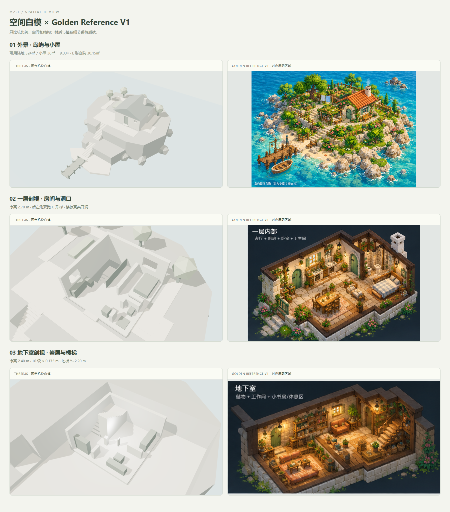
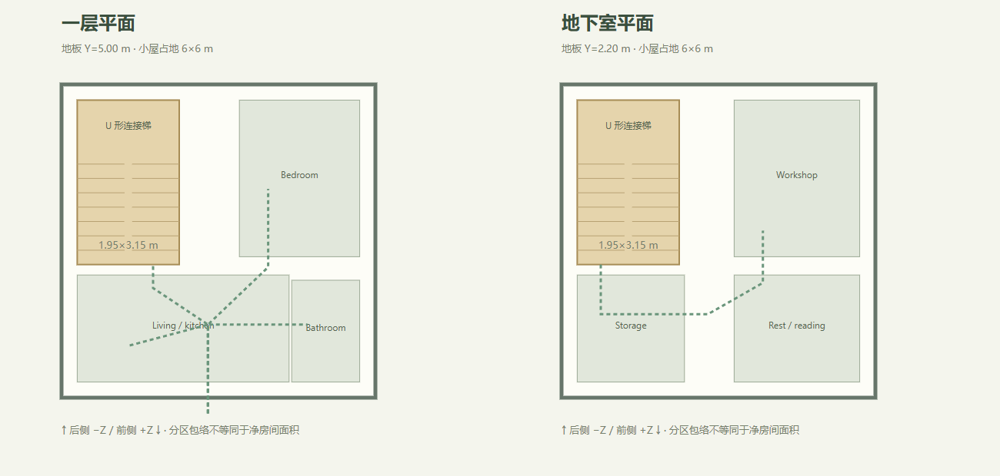
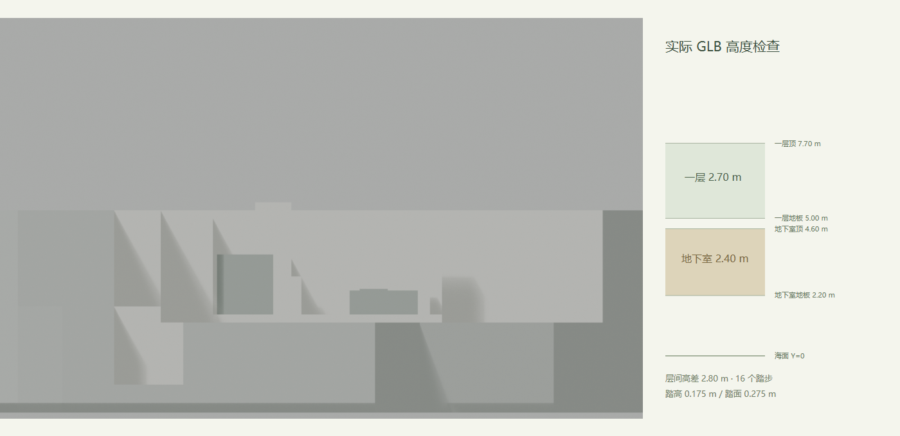

# M2.1 空间白模交付 — 待人工确认

Historical V0 handoff. **V0 was visually rejected on 2026-10-29**; original evidence/assets are preserved. Current corrective submission: [M2.1 V1 handoff](M2_1_V1_HANDOFF.md). The dimensions and approval request below are the original V0 record.


日期：2026-10-28。当前只完成空间白模候选版；M2.2 尚未开始。正式参考为用户提供的本地 `docs/references/golden-reference-v1.png`，来源与哈希见 [Golden Reference V1](GOLDEN_REFERENCE_V1.md)。参考方向用于构图与空间比较，概念剖视没有直接作为施工尺寸图。

## 可运行结果

Blender **5.2.1 LTS + Python** 生成参数化岛屿、小屋、真实岩层空腔、楼板梯洞和双跑楼梯，导出 GLB 接入 Three.js。外景、一层剖视、地下室剖视可以切换；重置恢复当前模式机位。M1 的鼠标/触摸、阻尼、resize、调试界面保留，原场景通过 `/?scene=foundation` 访问。加载失败显示错误并禁用模式按钮。

庭院、花园体块、两段海岸石阶、下层平台、沙滩、码头和基本通道已包含。使用 Three.js 内置材质、灯光与阴影；所有模型、家具、植物体块均为占位资产，无手绘纹理、精细植被、ComfyUI 或角色工作。

```sh
npm install
npm run dev
```

打开 <http://127.0.0.1:5173/>。完整命令和工具路径配置见 [README](../README.md)。

## 与正式参考并排检查

左列是实际 Three.js 固定机位截图，右列是正式参考对应区域。只检查空间、比例、楼层与路径；不以白模材质判断最终美术。







| 检查重点 | 本版实测/设计值 | 需要确认的判断 |
| --- | --- | --- |
| 岛屿 / 小屋 | 有效陆地 324 m² / 外墙占地 36 m² = 9.0000× | 完整岛屿是否留出足够空间；面积包含小屋与通道，排除海水、码头和外围石块 |
| 庭院 | L 形 30.145 m² | 入口、侧庭与花园空间是否合适 |
| 一层 | 地板 Y=5.00 m，净高 2.70 m | 一层建筑体量；卧室和浴室是否太紧凑 |
| 地下室 | 地板 Y=2.20 m，顶 Y=4.60 m，净高 2.40 m | 岩层包裹及层高；底板下表面 Y=2.00 m，高于海面 |
| 内楼梯 | 后左角 U 形，16×0.175 m 踏高，0.275 m 踏面 | 与参考右侧直梯不同，位置和形式需确认 |
| 楼梯洞口 / 通道 | 1.95×3.15 m，梯宽 0.90 m，平台 0.95 m，旁通道 0.94 m | 两层入口对齐，整个梯井有真实楼板开洞 |
| 室外路线 | 庭院 → 13 级石阶 → 平台 → 11 级石阶 → 沙滩 → 码头 | 台地高度与海岸路线可读性 |

岛屿是不规则轮廓，包围盒约 20.01×23.34 m；18×18 m 指等效面积，不是强制方形边界。为让 6×6 m 小屋内的楼梯和房间能真实衔接，本版采用后左 U 形梯。房间面积报告是分区包络，未当作扣除墙厚后的净建筑面积。详细层高、机位与节点契约见 [M2 spatial spec](M2_SPATIAL_SPEC.md)。

## 源文件、导出和截图

| 交付内容 | 路径 |
| --- | --- |
| 可编辑 Blender 场景 | [island_cottage_blockout_v1.blend](../art-source/blender/island_cottage_blockout_v1.blend) |
| Blender Python 生成器 / CLI wrapper | [generate_blockout.py](../scripts/generate_blockout.py)、[run_blender.mjs](../scripts/run_blender.mjs) |
| 源参数与固定机位 | [island_cottage_v1.json](../art-source/parameters/island_cottage_v1.json) |
| 场景 GLB / 轴测试 | [island GLB](../public/assets/models/island_cottage_blockout_v1.glb)、[axis GLB](../public/assets/models/axis_test_01.glb) |
| 运行时 manifest | [blockout_v1.json](../public/assets/manifests/blockout_v1.json) |
| Blender 三模式 | [外景](screenshots/m2.1/blender-exterior.png)、[一层](screenshots/m2.1/blender-ground-floor.png)、[地下室](screenshots/m2.1/blender-basement.png) |
| Blender 平面与剖面 | [一层平面](screenshots/m2.1/blender-ground-plan.png)、[地下室平面](screenshots/m2.1/blender-basement-plan.png)、[高度剖面](screenshots/m2.1/blender-section.png) |
| Three.js 三模式 | [外景](screenshots/m2.1/web-exterior.png)、[一层](screenshots/m2.1/web-ground-floor.png)、[地下室](screenshots/m2.1/web-basement.png) |
| Web 完整 UI | [外景 UI](screenshots/m2.1/web-exterior-ui.png)、[一层 UI](screenshots/m2.1/web-ground-floor-ui.png)、[地下室 UI](screenshots/m2.1/web-basement-ui.png) |
| 并排 / 平面 / 层高检查 | [参考并排](screenshots/m2.1/reference-comparison.png)、[平面](screenshots/m2.1/floor-plan-check.png)、[层高](screenshots/m2.1/height-and-stair-check.png) |

原始参考图片保留本地并通过精确 `.gitignore` 路径排除；应用户要求提交派生并排检查图。运行和构建不依赖原图；重新生成并排图需要原图。Blender 备份 `.blend1` 与缓存不提交。

## 改动文件

- `scripts/`：参数化建模/导出、实际 GLB 验证、静态对比图生成；`art-source/` 与 `public/assets/`：源文件、参数、GLB 和 manifest。
- `src/world/blockout.ts`、`src/config/blockout.ts`、`src/core/dispose.ts`：异步资产加载、类型验证、三种视图、灯光与资源释放。
- `src/app/Application.ts`、`src/app/shell.ts`、`src/style.css`：默认 M2 场景、模式按钮、空间数据、加载/错误 UI。
- `src/camera/ConstrainedCamera.ts`、`src/camera/math.ts`、`src/config/camera.ts`、`src/art-lab/debugPanel.ts`：profile 与模式重置；M1 默认参数保留，M2 距离扩展至 45 m。
- `tests/unit/blockout.test.ts`、`tests/browser/m2.spec.ts`：manifest、模式、加载失败和相机检查；`tests/browser/m1.spec.ts`：原场景回归、截图写到 `test-results/m1-regression/`，保留历史截图。
- `package.json`、`.gitignore`、README、M2 计划/参考/空间/艺术管线/验收和坐标文档，以及本交付文档与 `docs/m2.1/` 报告。

## 验证结果

| 命令/检查 | 2026-10-28 结果 |
| --- | --- |
| `npm run lint` | 通过，无 lint 警告 |
| `npm run typecheck` / `npm run build` | 通过，TypeScript strict；build 内运行 typecheck |
| `npm test` | 24/24 通过 |
| `npm run test:browser` | 11/11 通过，含 7 项 M1 回归和 4 项 M2 检查 |
| `npm run assets:blockout` | Blender 5.2.1 生成源文件、导出和六张截图成功 |
| `npm run assets:validate` | 54 项通过：实际解析、节点、UV、几何尺寸、梯洞、地下室空腔及真实轴转换 |
| 重复生成 | 相同参数/seed 的两次 GLB SHA-256 相同；不声称 `.blend` 字节一致 |
| `npm run evidence:compare` | 三张静态检查图生成成功，正式参考未修改 |
| `git diff --check` | 通过 |

GLB：231,156 bytes，127 个运行时网格图元、2,010 个几何三角形；Blender 源网格为 123 个，材质拆分会增加图元数。SHA-256：`8eca8043b21f6780d959b9d1ecbfa0261e911a9a8b653be6c5f552ea00393f32`。

Chrome 155.0.8059.85、1600×1000 页面固定机位记录：

| 模式 | Draw calls | 渲染三角形 |
| --- | --- | --- |
| 外景 | 233 | 3552 |
| 一层剖视 | 174 | 2640 |
| 地下室剖视 | 61 | 900 |

上述计数包含阴影绘制，区别于文件的几何三角形总数。页面没有控制台 error/warning；尚未测量 FPS，不宣称达到性能预算。构建 JS 667.45 kB（gzip 171.21 kB），保留 Vite 的 >500 kB 提醒。

原始报告：[空间](m2.1/spatial-report.json)、[资产验证](m2.1/asset-validation.json)、[GLB 复现](m2.1/reproducibility.json)、[Web 计数](m2.1/runtime-report.json)。

## 已知限制与下一步

地形为粗分层体块，植物/家具只表达占地和通道，水面平坦；屋顶、石块与海岸轮廓还需在后续美术阶段细化。地下室检查采用真实剖开的岩层变体，保留后/左岩壁；低内墙是检查专用副本。标准机位可读，但任意 GUI target 编辑并不受完整相机/建筑碰撞约束。已测桌面与竖屏按钮/resize，竖屏可能裁切岛屿，真实手机未认证。Blender AgX 与 Web ACES/灯光的明暗存在差异，以 Web 截图作为最终查看依据。生成器锁定 Blender 5.2.1；其材质 `use_nodes` 弃用提示不影响本版本执行。

等待用户确认 **岛屿/房屋比例、庭院空间、地下室净高、后左 U 形楼梯及小房间布局**。如需修改先继续 M2.1。确认后才进入 M2.2：以批准的尺寸制作小屋主资产，按轮廓 → 材质 → Blender/Web 对比逐步审阅；不提前启动植被库或 ComfyUI。
