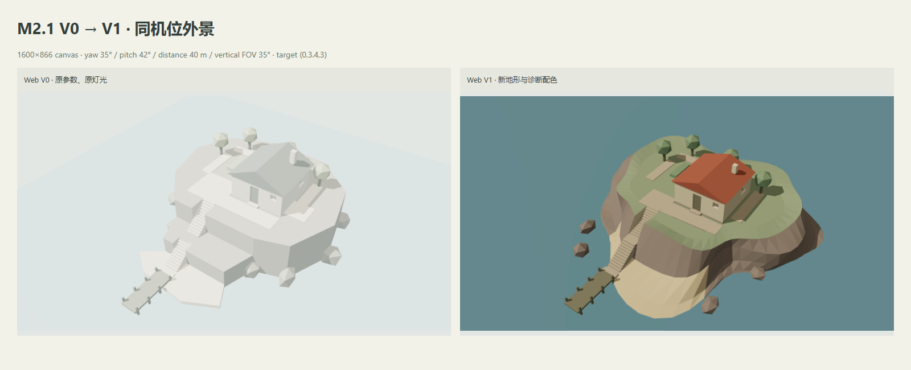
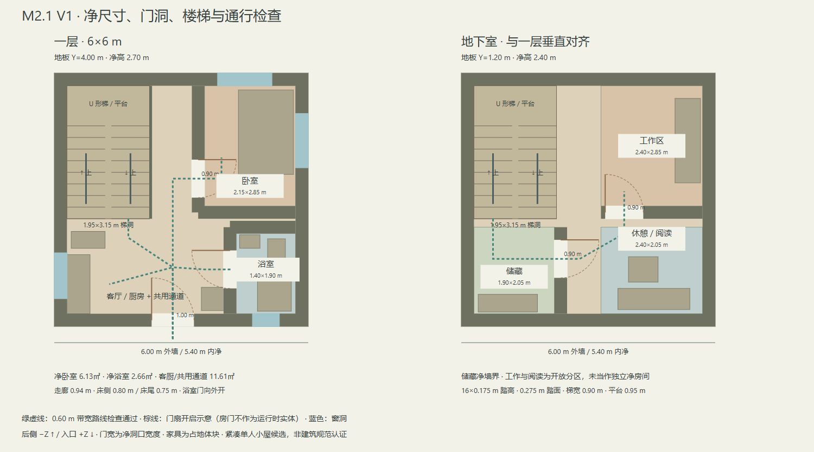
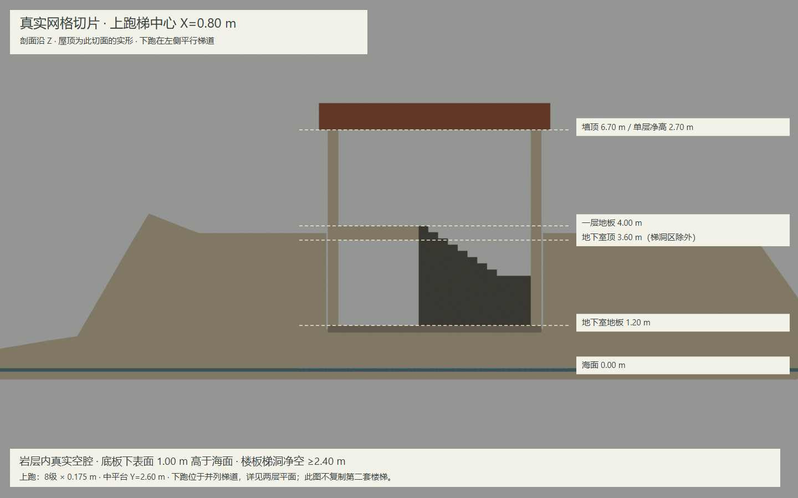

# M2.1 V1 修正交付与验收报告 — 等待人工确认

日期：2026-10-29。依据 [M2_1_REVIEW.md](M2_1_REVIEW.md) 完成 P0 → P1 → P2 修正；V0 视觉未通过的决定保留。分支 `codex/m2-1-v1-corrections`，基于评审提交 `765e575`。本次为可审阅的空间白模修正版，**M2.2 未开始；完成本交付后停止，等待人工确认**。

## 结果与对比

主体从分层棱柱改为连续的多环海岸网格，台地与建筑整体降低 1 m，屋顶起拱降到 1.15 m；小屋仍是 6×6 m、一个地上层和一个真实岩层地下室。外部庭院缩为 19.50㎡，台阶通过地形中的逐级凹槽连接到沙滩和码头。卧室门移到共用走廊侧，浴室扩大并加入洗手盆占地。配色与灯光改为可辨认墙、地板、屋顶、岩石和楼梯的诊断色块，未制作任何最终纹理。



[完整验收图](screenshots/m2.1-v1/review-sheet.png) 包含同机位 V0/V1、V1 与既有 Golden Reference 裁图、净尺寸平面、连通陆地测量、实网格剖面和 Three.js 三模式。概念图与 Web 透视/画幅不同，不做像素配准，不声称已达到视觉一致。正式参考原图哈希未变；重新生成时缺少本地原图可使用已提交 V0 派生图中的同一概念区域，来源会写入报告。

## 按评审优先级完成的修正

| 优先级 / 问题 | V1 实现与证据 | 验收边界 |
| --- | --- | --- |
| P0 岛屿像层叠底座 | 六环岸线至台地连续三角网格；非同心径向偏移、不同边高、倾斜岩肩、局部南侧沙滩；真实空腔与逐级台阶凹槽 | 结构替换完成；自然程度、局部宽岩面仍需人工判断 |
| P0 小屋与人工平台抢占画面 | 地台 4.80→3.80 m、一层地板 5.00→4.00 m；屋顶 1.60→1.15 m、檐 0.30→0.25 m；去除观景方板、缩小前庭、局部石挡边 | 同一机位可见变化；与参考的景观密度差异仍存在 |
| P1 面积凑整 | 不再按 9.0000 缩放；实际表面首命中去重、坡度筛选、门廊连通性、种植/孤立面排除；报告范围 8.5–9.5× | 有限网格测量；占用的小屋平台单列，不称为自由行走面积 |
| P1 室内不清晰 | 注释平面来自真实墙洞和家具范围；卧室改走廊侧门，浴室 1.40×1.90 m；门洞/开启示意、U 梯箭头、尺寸和通道齐全 | 紧凑单人布局候选；地下室部分为开放功能区，门扇仅示意 |
| P1 白模过曝 | 奶油墙、低饱和瓦色、暖灰岩、鼠尾草绿、沙色、灰蓝水；环境光 2.4→1.05、太阳 3→2、填光 8→1.5、曝光 1.15→1.00 | Three.js 截图已实际检查；Blender AgX 与 Web ACES 明暗仍不同 |
| P1 比较视图不等价 | Web V0/V1 同相机；参考透视差异说明；两层平面和上跑梯实际切片；三个 Web 模式 | 画幅与建筑大形可复核，不宣称视觉批准 |
| P2 V0 / 参考维护 | V0 原参数、Blend/GLB/轴资产/manifest/截图保存；新增独立 v2 资产及 m2.1-v1 证据；原图保持 ignored | 原图不参与 dev/build；V0 保留校验报告见下 |

## 平面、层高与比例





| 指标 | V1 测量 / 定义 |
| --- | --- |
| 小屋外墙 / 内净 | 6×6 m = 36㎡ / 5.40×5.40 m |
| 陆地目标 | 8.5–9.5×；实测 **333.21㎡ / 36㎡ = 9.2558×** |
| 连通可行走外部 | 297.21㎡ 投影；斜面实际面积 301.10㎡ |
| 面积排除项 | 种植床/树干 8.08㎡；不连通缓坡 10.91㎡；陡岩、海水、码头、装饰石不计 |
| 测量方法 | 0.10 m 网格，对实际地形/铺装/台阶首命中去重；Y≥0.24、坡度≤30°；从门廊四邻域连通，邻格高差≤0.24 m |
| 粗细网格差 | 0.20 / 0.10 m 测量差 1.35㎡，不假装无限精度 |
| 庭院 | 19.50㎡；有前庭到海岸台阶的通路 |
| 卧室 / 浴室 | 净墙面 2.15×2.85 = 6.128㎡ / 1.40×1.90 = 2.660㎡ |
| 客厅/厨房与共用通道 | 11.605㎡ 净地面；已扣墙、梯洞与闭合房间，未扣家具占地；不是图中标签矩形面积 |
| 一层 / 地下室 | 地板 Y=4.00 / 1.20 m；净高 2.70 / 2.40 m；顶 Y=6.70 / 3.60 m |
| 地下室海面净距 | 底板下表面 Y=1.00 m；海面 Y=0；实际岩层挖空 |
| U 形梯 | 1.95×3.15 m 梯洞；16×0.175 m；踏面 0.275 m；梯宽 0.90 m；平台 0.95 m；高差 2.80 m |
| 室内主要净距 | 门洞 1.00 / 0.90 / 0.90 m；通道 0.94 m；床侧/床尾 0.80 / 0.75 m；浴室入口到马桶 0.74 m |
| 通行检查 | 144 条带宽射线组，宽 0.60 m，在离地 0.25 / 1.10 / 2.05 m 检查真实墙洞与家具；梯洞容纳两跑 |
| 户外净宽 | 园路 1.20 m / 海岸梯 1.60 m / 码头 1.80 m；平台 0.90 m；13+11 级 |

[俯视陆地/小屋占地](screenshots/m2.1-v1/land-footprint.png) 显示去重后的真实连通投影。固定外景相机仍为 target (0,3.4,3)、yaw 35°、pitch 42°、distance 40 m、垂直 FOV 35°，截图 canvas 1600×866。实际顶点投影包围框：小屋宽占画布 20.12%→19.48%，高 31.24%→29.48%；岛屿宽 52.79%→59.78%。这些是包围框，不是像素占用率或“相似度评分”。[机位测量](m2.1-v1/camera-framing.json)。

比较了保留 6×6 m 与拓至 6.5×6 m 两个最小选择（后者仅作面积推算，未生成或验证完整候选）：6.5×6 m 可增加 3㎡，但改变小屋视觉占地和宽度；通过移动卧室入口、扩大浴室并保留共用通道，6×6 m 可作为单人紧凑候选，因此选保留占地这一最少改动。房间仍不宽裕；若人工认为床边/浴室或开门占用客厅不合适，应继续 M2.1 改平面，不能直接进入 M2.2。U 梯保留后左位置，与参考直梯有意不同。

## 资产、截图与运行

| 内容 | 文件 |
| --- | --- |
| Blender 5.2.1 源 | [island_cottage_blockout_v2.blend](../art-source/blender/island_cottage_blockout_v2.blend) |
| 源参数 / 诊断配色与灯光预设 | [island_cottage_v2.json](../art-source/parameters/island_cottage_v2.json) |
| GLB / 坐标校验 | [island GLB](../public/assets/models/island_cottage_blockout_v2.glb)、[axis GLB](../public/assets/models/axis_test_02.glb) |
| Runtime manifest | [blockout_v2.json](../public/assets/manifests/blockout_v2.json) |
| Web 三模式 | [外景](screenshots/m2.1-v1/web-exterior.png)、[一层](screenshots/m2.1-v1/web-ground-floor.png)、[地下室](screenshots/m2.1-v1/web-basement.png) |
| Web UI 证据 | [外景 UI](screenshots/m2.1-v1/web-exterior-ui.png)、[一层 UI](screenshots/m2.1-v1/web-ground-floor-ui.png)、[地下室 UI](screenshots/m2.1-v1/web-basement-ui.png) |
| Blender 三模式 | [外景](screenshots/m2.1-v1/blender-exterior.png)、[一层](screenshots/m2.1-v1/blender-ground-floor.png)、[地下室](screenshots/m2.1-v1/blender-basement.png) |
| Blender 平面 / 实物切片 | [一层俯视](screenshots/m2.1-v1/blender-ground-plan.png)、[地下室俯视](screenshots/m2.1-v1/blender-basement-plan.png)、[切片](screenshots/m2.1-v1/blender-section.png) |
| 可缩放注释源 | [平面 SVG](screenshots/m2.1-v1/annotated-plans.svg)、[面积 SVG](screenshots/m2.1-v1/land-footprint.svg)、[剖面 SVG](screenshots/m2.1-v1/annotated-section.svg) |
| 对比与报告 | [V0/V1](screenshots/m2.1-v1/v0-v1-exterior.png)、[完整图](screenshots/m2.1-v1/review-sheet.png)、[空间](m2.1-v1/spatial-report.json)、[资产](m2.1-v1/asset-validation.json)、[导出复现](m2.1-v1/reproducibility.json)、[V0 保留](m2.1-v1/v0-preservation.json)、[Web](m2.1-v1/runtime-report.json) |

```sh
npm install
npm run dev
npm run assets:blockout
npm run assets:reproduce
npm run assets:validate
npm run lint
npm run typecheck
npm test
npm run build
npm run test:browser
npm run evidence:compare
```

Blender/Chrome 路径与 Windows 环境变量示例见 [README](../README.md)。本地 <http://127.0.0.1:5173/> 为 V1，<http://127.0.0.1:5173/?version=v0> 为 V0，<http://127.0.0.1:5173/?scene=foundation> 为 M1。build/test 不要求 Blender或参考原图。Web 材质、阴影、sRGB、ACES 均用 Three.js 内置；无全屏像素化或新框架。

## 验证与性能记录

| 命令 / 检查 | 2026-10-29 结果 |
| --- | --- |
| `npm run assets:blockout` | Blender 5.2.1 生成源、导出、六张图成功 |
| `npm run assets:reproduce` | 两次 GLB SHA-256 相同；不声称 Blend 字节相同 |
| `npm run assets:validate` | 70 项通过：真实解析、UV/有限几何/节点、层高、两跑梯洞、9 点空腔检查、真实轴转换、面积/连通排除统计 |
| `npm run lint` | 通过，无 lint 警告 |
| `npm run typecheck` / `npm run build` | strict 通过；build 内含 typecheck |
| `npm test` | 26/26 通过 |
| `npm run test:browser` | 11/11 通过，7 项 M1 + 4 项 M2，包含 V0 对比加载、三模式、错误、相机和竖屏 |
| `npm run evidence:compare` | 对比、平面、面积与剖面生成；Web 模型哈希与导出匹配；V0 资产/截图保留检查通过 |
| `git diff --check` | 通过 |

GLB：**372,264 bytes，126 个导出网格图元、3,886 个文件几何三角形**；Blender 源网格 120 个。SHA-256：`2992f132f2c6f852475568074c5481dc0730a0667e369bbc54c18779df32c51d`。120 个源网格与材质拆分后的 126 个导出图元为不同统计口径；低于本候选诊断网格 10k 三角形检查线。

Chrome 155.0.8059.85，1600×1000 页面 / 1600×866 canvas：

| 模式 | Draw calls | 渲染三角形（含阴影） |
| --- | --- | --- |
| exterior | 231 | 5604 |
| ground-floor | 172 | 4680 |
| basement | 61 | 2600 |

控制台 error/warning 列表为空。未测 FPS，不声称通过性能预算。build JS 668.38 kB / gzip 171.52 kB，保留 Vite >500 kB 提醒；Blender 的 use_nodes 弃用提示及 Playwright 启动器 NO_COLOR 提示不影响执行。

## 改动文件与已知限制

- 建模/测量：`scripts/generate_blockout.py`、`terrain_blockout.py`、`survey_blockout.py`；导出 wrapper、验证、重复导出、对比/注释脚本；V0 脚本另存 `scripts/archive/`。
- Runtime：`src/config/blockout.ts`、`src/world/blockout.ts`、`src/app/Application.ts`；版本 URL、按 manifest 灯光/曝光、模式状态与模型哈希；M1 相机代码未改。
- 资产/证据：新增 v2 参数、Blend、GLB、轴 GLB、manifest；`docs/m2.1-v1/` 与 `docs/screenshots/m2.1-v1/`。原 V0 二进制与截图保留。
- 测试/文档：unit/browser M2 验证、package 命令、README、空间/资产/艺术管线/验收/本报告；V0 handoff 仅新增历史状态说明。精确列表见 [changed-files.json](m2.1-v1/changed-files.json)。

所有植物、家具、岩块和水体仍是占位体块。局部岩肩较宽、上台地仍保留可使用的平面，景观层次与参考有差距；本次没有用密集装饰掩盖大形。浴室向外开门会占用部分共用客厅，门扇状态/碰撞未实现；地下室工作/阅读为开放分区。面积采样验证不是 M3 导航系统；真实手机、FPS 和任意相机目标碰撞未认证。剖面切过上跑，低跑在并列梯道，不在同一切面中。诊断 UV 非最终展开，颜色非最终材质。

**偏差记录：** 已修正分层底座生成方式、屋顶/地台标高、门洞冲突、面积凑整与过曝；有意保留 6×6 m、后左 U 梯和开放地下室功能区；自然度、岛屿/小屋视觉比例、紧凑浴室与门扇取舍仍待人工判断。工程检查不能替代最后一项。

**停止点：** 当前 [M2 acceptance](M2_ACCEPTANCE.md) 的人工确认项未勾选。等待人工评审本 V1；若仍需修正，继续 M2.1。只有明确批准后才提议 M2.2 的小屋主资产轮廓制作，本次不启动瓦片、纹理、精细植被、ComfyUI 或角色。
