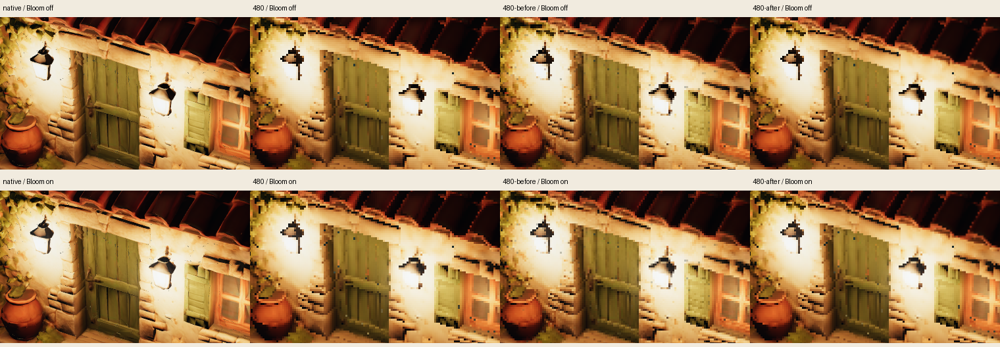

# H3-B 门灯与窗户 Bloom

夜景的两盏门灯周围可见局部暖光晕，窗户变化较弱。四组同机位 A/B 中，开启 Bloom 后，约 1.04% 至 1.07% 的画布像素在至少一个 RGB 通道上的变化超过 5/255。验收时请分别检查灯罩边缘、门框和窗格是否还能读清，以及两种景深顺序下的光晕是否自然。

## 固定参数与性能

统一使用 H3-A 夜景、小屋近景、原有两盏门灯及窗户局部光源。视口 1440×960，画布 1440×826，Pixel 480 为 480×275。两组 DOF 的焦点距离均为 12 m，低分辨率 MSAA 关闭。每组只切换 Bloom。以下为 Chromium 157.0.8103.52、预热 20 帧后连续 90 帧的 requestAnimationFrame 间隔。四组开关前后的 P95 均为 16.80 ms；受刷新节奏限制，本次记录不能分辨细小的 GPU 耗时差。

| 夜景方案 | Draw calls 关 → 开 | 平均帧间隔 ms 关 → 开 | 变化超过阈值的画布比例 |
|---|---:|---:|---:|
| Native | 10 → 11 | 16.66 → 16.67 | 1.044% |
| Pixel 480 | 11 → 11 | 16.67 → 16.67 | 1.064% |
| 先景深后像素化 | 12 → 12 | 16.67 → 16.67 | 1.036% |
| 先像素化后景深 | 11 → 12 | 16.67 → 16.67 | 1.065% |

四组超过阈值的变化都位于画布 x=490–899、y=378–555 的门窗区域。完整画布可用于检查远处植被、地面和瓦面。[八张全幅截图](bloom/) · [单组变化边界](metrics.json) · [每张截图的 URL、相机矩阵及性能](captures.json)

## 实现与复现

在当前场景旁保留 H3-A 的三处光源锚点，投影到屏幕后，从可见颜色与深度中提取邻近亮部。门灯采光半径 0.28 m，窗户 0.42 m，扩散半径 0.44 m，每处使用 40 个采样点。亮度权重在 0.52–0.90 间过渡，深度偏差在 0.32–0.75 m 间衰减，最后限制合成强度。Bloom 默认关闭，可与 Pixel、DOF 分别切换。该实验使用已有画面亮度，窗光强弱取决于可见表面和现有光照；屏幕空间深度仅包含最前层表面。

运行 `npm run dev` 后访问 `/?scene=courtyard&shot=house&sky=night&render=pixel&pixelWidth=480&bloom=1`。在同一视角关闭 Bloom 对照，或附加 `&dof=1&focus=12&order=before` 或 `&dof=1&focus=12&order=after`。运行 `npx playwright test tests/browser/h3-b.spec.ts` 重采截图与帧间隔，再运行本目录的 `measure.py` 生成裁切及差分记录。

渲染改动在 `src/core/LampBloom.ts` 和 `src/core/PixelPresentation.ts`，庭院光源锚点与诊断入口位于 `src/world/`，界面接线位于 `src/app/Application.ts`。回归检查通过 typecheck、ESLint、Vite 生产构建、24 项单元测试及 17 项浏览器测试。构建保留 Vite 的大于 500 kB 分块提示。H3-B 浏览器检查覆盖 GL 错误、开关持久化和成对截图变化。

Bloom 与[小屋白点排查](SAMPLING.md)分别等待人工视觉验收。下一里程碑 H4 由人工确认后启动。
