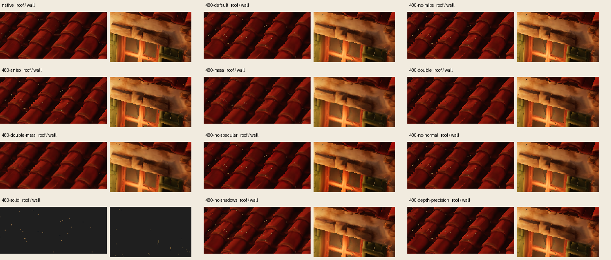

# H3-B 小屋白点排查

黄昏近景中，屋瓦和墙面的一部分孤立亮点来自模型表面的正面覆盖缺口。低分辨率渲染把一次漏采样放大成了可见色块。优先建议在 Pixel 模式试用 4× MSAA。它保留最近邻像素输出，对这两个区域的改善都比调整纹理过滤明显。

## 同机位对照

按用户截图设置黄昏、门窗局部光与主光投影开启，关闭 Bloom 和 DOF。近景距离 9 m，俯角 30°，偏转约 −2.09°。视口 808×830，画布 808×696，Pixel 480 实际为 480×413，与参考截图的内部高度相差一行。23 张采集图使用相同相机矩阵。对照板均从最终画布直接裁切，左为屋瓦、右为含窗墙体，按原图 100% 查看。[完整截图](sampling/) · [逐图 URL 与相机矩阵](captures.json)

表中为屋瓦 / 墙体的亮峰数。Native 基准为 **26 / 10**。计算时回到各自的内部采样网格，统计比邻域 3×3 中值亮超过 32 灰阶的样本。阈值也会捕捉真实纹理细节，且不同分辨率的样本总数不同，改善幅度应在同一列内比较。[逐项数值与采样数](metrics.json)

| 单变量或组合 | Pixel 480 | Pixel 640 | 固定机位下的观察 |
|---|---:|---:|---|
| 原始 | 35 / 22 | 62 / 35 | 两个区域均可见零星亮点 |
| 禁用 Mipmap，线性过滤 | 38 / 42 | 66 / 46 | 墙面亮峰增加 |
| 各向异性过滤，最高 8× | 36 / 36 | 65 / 41 | 未改善 |
| **低分辨率 4× MSAA** | **7 / 3** | **17 / 5** | 两个区域的亮峰均显著下降 |
| 双面绘制 | 11 / 14 | 21 / 17 | 背面参与覆盖后，亮峰减少 |
| 双面 + 4× MSAA | 0 / 4 | 1 / 5 | 屋瓦进一步改善，墙面与单开 MSAA 接近 |
| 移除镜面反射 | 31 / 24 | 60 / 34 | 亮点仍在 |
| 禁用法线贴图 | 35 / 20 | 63 / 38 | 亮点仍在 |
| 替换为纯灰无光材质 | 28 / 26 | 58 / 51 | 可隔离不依赖贴图或光照的亮点 |
| 关闭主光投影 | 34 / 35 | 64 / 46 | 亮点仍在 |
| 提高深度精度，近平面从 0.1 调至 1 m | 35 / 22 | 62 / 35 | 计数与原始一致 |

## 成因与取舍

原 GLB 已使用线性放大、三线性 Mipmap 缩小过滤。对纯灰实验中的亮峰逐点从相机向小屋三角形发射射线，480 档屋瓦 28/28、墙面 26/26，640 档屋瓦 58/58、墙面 51/51，全部只命中背面。默认背面剔除时，这些采样点会露出后方颜色。精确位置焊接后检出 55,290 条单侧边，未检出顶点位置完全相同的重复三角形。射线结果支持所测位置存在正面覆盖缺口，单侧边总数不能直接换算为可见裂缝数。深度精度实验也未显示共面深度冲突是这批亮点的主因。

建议先单开 MSAA 接受视觉验收。双面绘制也会显示模型内部表面，本轮仅作为诊断选项。原模型和贴图保持原样。剩余亮点中可能包含真实材质细节，以上射线结论仅覆盖纯灰探针命中的样本。

## 复现

运行 `npm run dev` 后访问 `/?scene=courtyard&sky=dusk&shot=detail&render=pixel&pixelWidth=480&dof=0&bloom=0&msaa=4`。切换 MSAA 或将宽度改为 640，可复核以上对照。添加 `&probe=double` 检查双面组合。MSAA 默认关闭，需要设备支持；先景深后像素化走全分辨率几何渲染，该顺序下低分辨率 MSAA 控件禁用。

运行 `npx playwright test tests/browser/h3-b.spec.ts` 重新采集，随后运行同目录的 `measure.py` 和 `trace_roof.py`。两个脚本使用 Python、NumPy 与 Pillow，射线脚本针对当前小屋预览 GLB 和固定镜头。白点改善等待独立人工验收。
