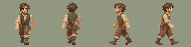
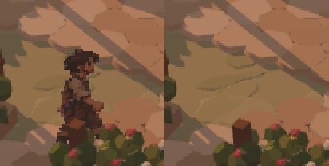

# H4 庭院园丁

打开 `/?scene=courtyard` 可看到男性园丁沿石板路从院门走向小屋，再原路返回。右上角「调试参数 → 庭院园丁」可隐藏角色、暂停在当前帧，或把速度调到 0.5–2.0 米/秒。默认速度 1 米/秒，两端分别停留 0.5 秒，一次往返约 15.93 秒。

## 素材与步态

三张原图均为 1254×1254 RGB 图，每张有四行、每行四个姿势，浅色背景已经合成到图中。男园丁四行依次为正面、背面、向左、向右。女园丁和猫的原图保存在素材目录，运行时仅加载男园丁。

提取脚本在每格顶部估计背景色，按颜色距离提取轮廓，裁切后用最近邻归一到 44 个可见像素高，按头部上段的中线对齐。输出的 16 格均为 48×48，透明度仅含 0、255，脚底边界均在第 46 像素线。JSON 以左上为原点，记录各方向的行走序列、静止帧、裁切框及共用脚底锚点 (24,46)。每个方向的静止帧复用第二个姿势。

侧面两种腿部轮廓交替清楚，正背面相邻帧差异较小。四帧循环保留了原图衣物、五官及步幅的小幅变化，最近邻缩小后细节仍会轻微跳动。素材没有独立站姿，停住时会保留轻微屈腿。[图集](../../../public/assets/sprites/gardener.png) · [帧数据](../../../public/assets/sprites/gardener.json) · [提取脚本](../../../scripts/prepare_gardener.py)

## 空间、遮挡与动画

采用 Three.js 的 Y-up 世界坐标，单位为米。沿现有道路中心采样 12 个点，从 A (−2.70, 0.101, 6.20) 到 B (1.57, 0.101, 0.15)，单程 7.47 米。脚底略高于最高铺路石表面，石缝处沿用路面高度。角色可见高度 1.72 米，约为小屋 6.7 米宽度的四分之一。

平面绕世界 Y 轴朝向相机，始终直立。按相机与角色的水平相对方位，将运动方向映射到四个朝向。模拟按帧间真实经过的秒数积分，并处理跨越路段、转向和等待的剩余时间。动画每移动 0.16 米切换一帧，因此调速会同步改变步频。角色使用受光材质、最近邻采样和 alphaTest，实体像素参与深度测试及写入，透明区域可透出背景。脚底椭圆提供接地阴影，角色可接收场景投影。

## 视觉验收与复现

运行 `npm install`、`npm run dev`，在本地开发地址后附加下表查询参数。固定画面采用 1280×850 视口；`walk=0` 会冻结给定时刻，省略它即可从该时刻继续行走。调试控制仅作用于当前页面。

| 观察项 | 可复现画面或操作 |
|---|---|
| 入口静止、整体比例 | [白天 Native](day-native-0.png) · `?scene=courtyard&walk=0` |
| 移动与接地 | [小屋近景 Pixel 480](walking-house.png) · `?scene=courtyard&shot=house&render=pixel&pixelWidth=480&walkTime=5&walk=0` |
| 被院门与花坛遮挡 | [黄昏 Native](dusk-native-0.png) · [同机位隐藏园丁](gate-hidden.png) · `?scene=courtyard&sky=dusk&walkTime=2.45&walk=0` |
| 低分辨率边缘 | [黄昏 Pixel 480 + MSAA](dusk-msaa-0.png) · 与上一行比较头发、靴子及石板轮廓 |
| 夜间组合 | [夜景 Pixel 480 + DOF + Bloom](night-dof-1.png) · 与门前受光表面一起检查角色可读性 |
| 深度对焦 | [焦距 10 m](focus-near.png) · [焦距 35 m](focus-far.png) · 同一近景、同一走姿，先景深后像素化 |
| 缩放与旋转极值 | 冻结在第 6.5 秒、入口镜头、Pixel 480，分别观察 [9 m / 偏转 −45°](orbit-near.png) 和 [38 m / 偏转 +45°](orbit-far.png)。世界坐标均为 x=0.575、z=1.228，朝向随视线切为背面、右侧 |
| 连续走动、转向与相机 | `?scene=courtyard&walkTime=7.55&shot=house`，先观察门前停顿与转身，再拖动和滚轮缩放。入口机位完整观察一圈约需 16 秒 |

下图为同一帧的院门裁切，使用最近邻放大两倍。左图园丁走在门柱和花坛后方，右图隐藏园丁，可核对前景遮挡的具体位置。

在入口全景，Pixel 480 会把角色缩到少量内部像素，细小手脚可能在相邻帧看起来粗细不同；近景更容易辨认步态。固定深度平面可以正确被前景几何遮挡，但没有身体厚度，极端俯视角下会出现纸片感。接地阴影为固定椭圆，不模拟随主光方向变化的人形投影。夜景、遮挡与离焦会进一步降低轮廓可读性。

## 验证入口

本机 Chrome 157.0.8103.52、RTX 3060、WebGL2 / D3D11 下，24 组平均帧间隔为 16.66–16.68 ms，P95 为 16.8–17.1 ms，记录到每帧 12–14 次绘制。类型检查、ESLint、生产构建均通过，26 项单元测试、19 项浏览器测试全部通过。近景 10 m 对焦时可分辨头发和双腿轮廓，35 m 对焦时园丁和门前铺石一起虚化；夜景远景下园丁与花坛的明度接近，辨识度较低。视觉融合程度留待第一轮统一评估。

- `python scripts/prepare_gardener.py` 从素材重建图集与元数据，需要 Pillow 和 NumPy。
- `npm run lint`、`npm test`、`npm run build` 检查静态规则、运动模拟、类型与生产构建。
- 构建后执行 `npm run test:browser`。H4 检查 Native、Pixel 480、480 + MSAA、480 + DOF，分别组合三种时段和 Bloom 开关，共 24 组。每组预热 8 帧、采集 30 个 rAF 间隔，记录均值、P95、绘制次数与 URL。间隔包含浏览器调度并受刷新率限制。[逐组记录](captures.json)
- Windows 下可将 `PLAYWRIGHT_BROWSER_PATH` 设为已安装的 Chrome 可执行文件以复用本机 GPU；使用代理时，为 localhost 和 127.0.0.1 设置 NO_PROXY。

运动计算见 `src/character/roadWalk.ts`，图集、材质和调试接线见 `src/character/gardener.ts` 与 `src/app/Application.ts`。既有庭院实验的截图入口显式设置 `actor=0`，便于继续对比历史基准。
