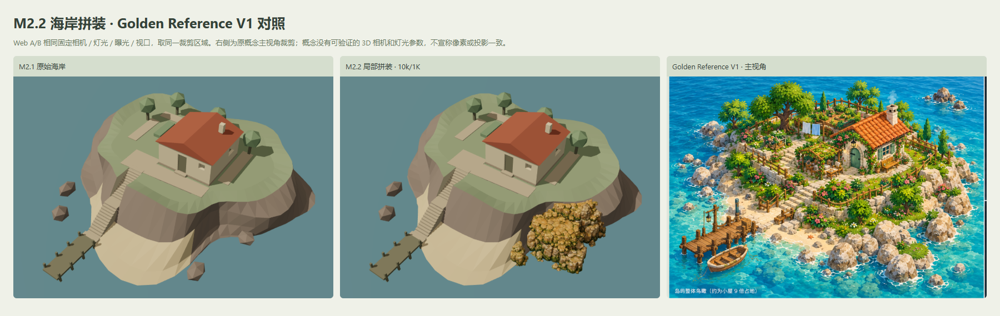
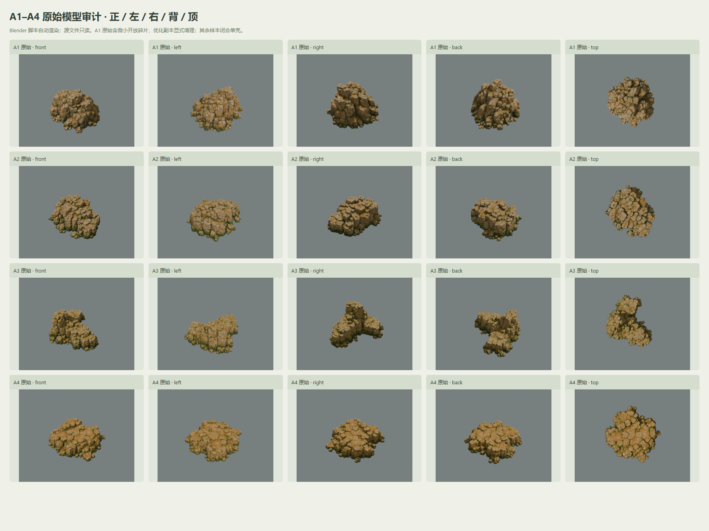
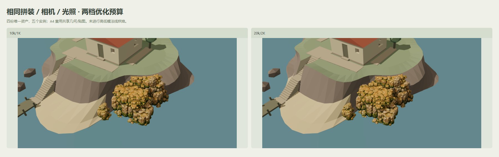
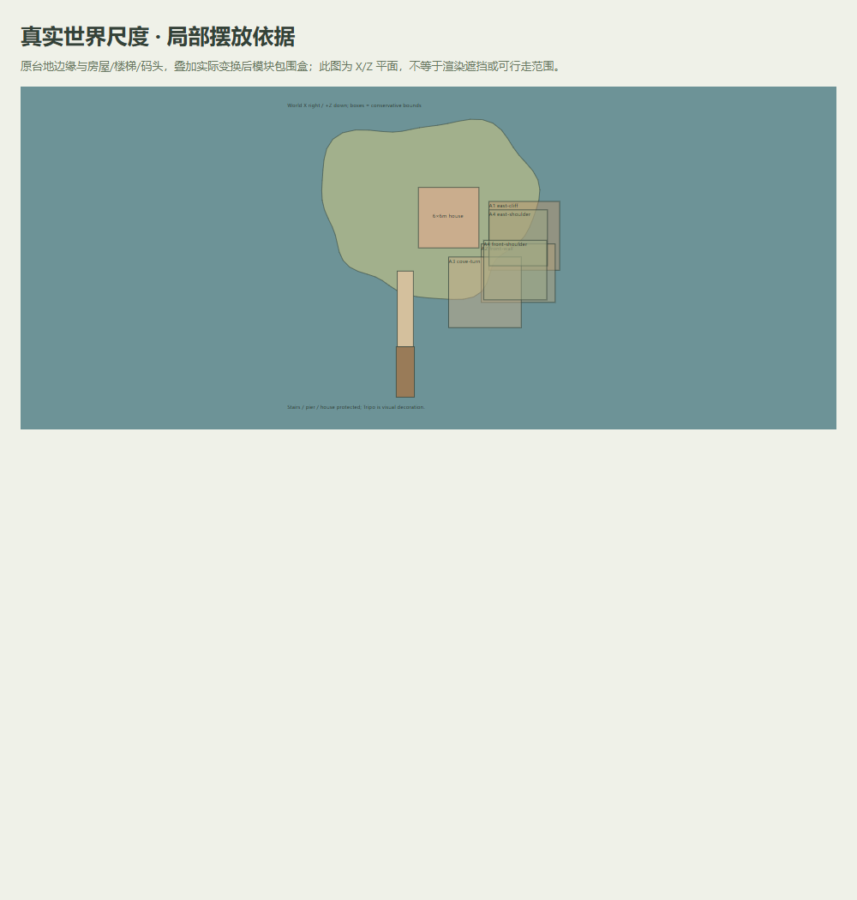

# M2.2 海岸模块拼装实验 — 验收报告

日期：2026-10-29。分支：`codex/m2-2-coastal-assembly`，从用户指定的当前 Tripo 实验分支建立；基线资产按 `dd5e076` 校验。状态：**工程流程与回归通过；视觉闸门未批准，停止等待人工审图。** 未合并，未购买/生成新 Tripo 模型，未进入下一轮大范围重建。

## 结论

A1–A4 都已检测、优化、规范化并在局部海岸拼装。默认 **10k/1K** 为五实例约 50k 三角形、四份唯一 GLB 合计 7.92 MiB、贴图估算 64 MiB；近景备选 **20k/2K** 为约 100k 三角形、22.65 MiB、贴图估算 256 MiB。A4 的两个实例共享几何与贴图，仅材质颜色乘数不同。当前局部岩块比原低面数占位更有裂隙和不规则边缘，但**白模与带纹理岩石的材质断层、台地上沿接缝及堆叠/块状感仍明显，不声称已经达到 Golden Reference 的自然完整海岸**。

Web A/B 使用现有 exterior 原参数：target [0,3.4,3]，yaw 35°，pitch 42°，distance 40m，FOV 35°，原 Hemisphere=1.05、Sun=2、曝光=1，完全相同视口；上图 Web 两列使用同一 x=320, y=81.10000000000001, w=1040, h=729.9 裁剪，完整截图另存，便于与概念的岛屿占画比例对照。Golden Reference 取 unchanged local Golden Reference V1 main-panel crop; SHA-256 6d538a42441a2c9b5b2e6736522687fa85aef08b8d87e1a71b0fa3ec2a1e61e3；概念画没有可验证的相机/灯光数据，故右列是主视角风格对照，不能称为相同投影或灯光复现。未改动或生成新参考。

## 原始资产审计

| ID | 原始 tris | 原始 MiB | 壳体 | 开放边 | 规范化尺寸 X/Y/Z m（10k） |
| --- | ---: | ---: | ---: | ---: | --- |
| A1 | 1,992,384 | 70.79 | 10 | 24 | 5.79 × 3.28 × 5.80 |
| A2 | 1,895,462 | 66.63 | 1 | 0 | 6.00 × 2.07 × 5.49 |
| A3 | 1,894,158 | 65.99 | 1 | 0 | 5.00 × 2.27 × 4.94 |
| A4 | 1,879,474 | 65.85 | 1 | 0 | 4.81 × 1.02 × 4.69 |

四份输入实际均为一 mesh / 一 primitive / 一 material / 三张 4096² 嵌入图：baseColor JPEG、ORM JPEG、normal PNG，有 UV 与法线。标准 glTF Y-up；Blender 导入 Z-up，再标准导出 Y-up。原始 SHA、节点/材质/纹理/范围在 `artifacts/coastal-assembly/A*/inspection.json` 和 [asset-manifest.json](asset-manifest.json)。原始 GLB 保持字节哈希不变。

A1 有 10 个壳体：主壳 996,176 顶点，加 9 个 3–4 顶点微小碎片，共 28 顶点，24 条开放/非流形边。仅在复制的中间高模清除配置阈值 ≤32 顶点的碎片，限制删除总数 <0.1%；原始参照高模保留。清理后和两档 LOD 为闭合单壳，实际清理统计见 A1 optimization.cleanup。A2–A4 原始为闭合单壳。闭合性不证明无内部自交或隐藏面；未执行可靠的内部面剔除。

扩展只有未使用的 `KHR_materials_volume` / `FB_ngon_encoding` 声明，没有 required 或实际材质扩展 payload；本次转换成标准 PBR。未来多 mesh、多材质、多 primitive、实际扩展或不同贴图绑定会明确报错，需要显式转换；不假设所有 Tripo 输入都兼容。

A1 是块状岩石团而非薄壁：源高度/宽度约 0.565，规范化宽 5.8m 后高约 3.28m。A2/A3/A4 高度分别约 2.08/2.28/1.03m。按实测尺寸与现有台地 3.8m 配置，不采用此前估算。多视图样本的侧背有可用体积，但仍保留规则层状裂纹及重复石块纹理。

## 批处理 / LOD

| ID | LOD | 实际 tris | GLB MiB | 三图尺寸 | RGBA+mip 估算 MiB |
| --- | --- | ---: | ---: | --- | ---: |
| A1 | 20k-2k | 20,000 | 6.04 | 2048×2048 / 2048×2048 / 2048×2048 | 64.00 |
| A1 | 10k-1k | 10,000 | 2.09 | 1024×1024 / 1024×1024 / 1024×1024 | 16.00 |
| A2 | 20k-2k | 20,000 | 5.62 | 2048×2048 / 2048×2048 / 2048×2048 | 64.00 |
| A2 | 10k-1k | 10,000 | 1.99 | 1024×1024 / 1024×1024 / 1024×1024 | 16.00 |
| A3 | 20k-2k | 20,000 | 5.44 | 2048×2048 / 2048×2048 / 2048×2048 | 64.00 |
| A3 | 10k-1k | 10,000 | 1.92 | 1024×1024 / 1024×1024 / 1024×1024 | 16.00 |
| A4 | 20k-2k | 20,000 | 5.55 | 2048×2048 / 2048×2048 / 2048×2048 | 64.00 |
| A4 | 10k-1k | 10,000 | 1.93 | 1024×1024 / 1024×1024 / 1024×1024 | 16.00 |

Blender 5.2.1 LTS 背景脚本：自动导入、原始拓扑审计、底部中心锚点和均匀 X 宽归一化、可选微碎片清理、渐进 COLLAPSE/QEM 20k→10k、缩图、导出几何和重新装配原始 PBR 材质字段。工作目录保留 master、原始贴图/纯几何缓存、原始 GLB 字节副本和中间 10k/2K、20k/1K 候选；Web manifest 仅公布两档规定候选。

baseColor sRGB；normal/ORM linear，ORM G=roughness、B=metalness；UV 和切线空间 normal 图保留，**没有 high→low 法线烘焙**。没有 KTX2、Draco 或 mandatory decoder；JPEG/PNG 解码由浏览器/GLTFLoader 完成，mipmap 由 Three.js 生成。估算按三张 RGBA8 + 完整 mip 链，不代表真实 VRAM。

重复优化两次，8 个候选检查通过；统计容差为 triangles 0.5%、GLB bytes 0.1%、尺寸 0.02m，三图尺寸与贴图 SHA 必须完全一致。4/8 的完整文件 SHA 相同；不保证字节相同，始终以当次 manifest 为准。详见 `reproducibility.json`。

## 局部拼装与原结构保护

摆放来自 `public/assets/presets/coastal-assembly.json`；五个实例覆盖前/东侧弧段，台地边缘保守估算 14.20 / 64.10m，即 **22.2%**。这是原边缘线段中点落入世界 AABB 的占地估计，不是屏幕可见占比、全海岸真实表面积或可行走面积。

房屋 6×6m、house center [2,-1]、地上 floorY=4、地下室 floorY=1.2；台地 3.8、海滩 0.45；楼梯 x=-2.3、startZ=4.3、宽1.6，码头 startZ=11.8、长5、宽1.8、deckY=0.65。参数、原 GLB/Blender 和 manifest 哈希均与基线一致，所有实例世界包围盒避开房屋/地下室/外楼梯/码头保护体。

原 Terrain、可行走面、房屋地基、地下室 cavity、台地、楼梯和码头不变，未增加 Tripo 碰撞/寻路/地形职责。实验拼装模式仅隐藏被覆盖的两个 `Coastal_Rock_Visual_02/03` 装饰占位；baseline 模式恢复，独立 M2.1 页面完全保留。两个 A4 上沿嵌入原地形和相邻岩块，中心向下射线有支撑；该检查不保证每个悬挑位置都无视觉裂缝。

A1 Y scale=1.2、A2 [1.15,1.2,0.95]、A3 [1.1,1.15,0.95]；其余缩放见 JSON，全部在 0.8–1.2，最大非等比比值 ≤1.3。没有镜像、负缩放；Three.js 标准法线矩阵处理缩放。轻微蓝通道颜色乘数缓和偏黄，但未重画贴图或替换粗糙度图。近景须继续人工检查拉伸和砌墙感。

## 实测性能

Chrome 155.0.8059.85，GPU：ANGLE (Intel, Intel(R) UHD Graphics 770 (0x0000A780) Direct3D11 vs_5_0 ps_5_0, D3D11)。60 帧预热 + 120 RAF 间隔；CPU render 提交 p95 另见 JSON，不含 GPU 完成。模型数列为实例 / 唯一资产；draw calls / render triangles 含阴影、基线及视锥裁剪；GLB bytes 和贴图估算只计额外 Tripo 模块。fetch/parse 为 localhost 顺序加载累计，不代表互联网冷下载。

| canvas | 配置 | 实例/资产 | calls | render tris | GLB MiB | texture MiB | fetch/parse ms | FPS | frame p95 ms |
| --- | --- | ---: | ---: | ---: | ---: | ---: | ---: | ---: | ---: |
| 1600×811 | baseline / 10k-1k | 0 / 0 | 231 | 5,604 | 0.00 | 0.00 | 0.0 / 0.0 | 54.01 | 20.00 |
| 1600×811 | assembly / 10k-1k | 5 / 4 | 237 | 105,524 | 7.92 | 64.00 | 131.3 / 146.4 | 54.44 | 20.00 |
| 1600×811 | assembly / 20k-2k | 5 / 4 | 237 | 205,524 | 22.65 | 256.00 | 2202.2 / 399.0 | 60.00 | 16.80 |

模拟移动和窄面板均在同一桌面 Chrome/GPU，**不是真机手机测试**。移动默认 10k/1K，额外纹理估算64MiB；20k/2K 升至256MiB，不能据桌面表现承诺物理手机内存安全。

| canvas | 配置 | 实例/资产 | calls | render tris | GLB MiB | texture MiB | fetch/parse ms | FPS | frame p95 ms |
| --- | --- | ---: | ---: | ---: | ---: | ---: | ---: | ---: | ---: | ---: |
| 390×583 | baseline / 10k-1k | 0 / 0 | 226 | 5,536 | 0.00 | 0.00 | 0.0 / 0.0 | 60.00 | 16.80 |
| 390×583 | assembly / 10k-1k | 5 / 4 | 232 | 105,456 | 7.92 | 64.00 | 38.4 / 97.4 | 60.00 | 16.80 |
| 740×589 | baseline / 10k-1k | 0 / 0 | 231 | 5,604 | 0.00 | 0.00 | 0.0 / 0.0 | 60.00 | 16.80 |
| 740×589 | assembly / 10k-1k | 5 / 4 | 237 | 105,524 | 7.92 | 64.00 | 33.9 / 98.3 | 60.01 | 16.80 |
| 844×247 | baseline / 10k-1k | 0 / 0 | 231 | 5,604 | 0.00 | 0.00 | 0.0 / 0.0 | 60.00 | 16.80 |
| 844×247 | assembly / 10k-1k | 5 / 4 | 237 | 105,524 | 7.92 | 64.00 | 34.0 / 96.1 | 60.00 | 16.80 |

若各配置贴近60 FPS，只能说明这台桌面和本轮采样没有掉帧，受刷新率限制，不证明帧率提高或支持大量复制。完整加载、帧时长、CPU提交和移动窗口数据在 `browser-{desktop,mobile,modules}.json`。

## 自动验收 / 已知问题 / 停止点

- [x] 输入只读，四资产原始五面截图、审计和8候选验证；规范化、PBR绑定、UV/法线、轴/原点与世界尺寸通过。
- [x] 一键命令完整运行、逐项重跑、重复统计校验，lint、strict typecheck、build、**32 单元 / 20 浏览器测试**通过。浏览器覆盖 A/B、模块检查、两档LOD、缺 GLB/不完整manifest提示和移动布局；旧 M1/M2/Tripo 回归通过。最终海岸代码另跑 6 项（含新增初始加载切换回归），与未变的14项基础/Tripo回归合计覆盖当前20项；checks.json保留两次验证的范围。
- [x] M2.1 原资产参数/二进制不变，实验开关和返回可用；原始/生成大 GLB 与 Blender/纹理缓存被忽略。
- [ ] **视觉闸门未批准**：局部带纹理区域与白模界限、上沿缺乏薄过渡带、岩石堆的规则块/裂纹感仍存在；背/顶近景不能代表无接缝。与 Golden 的岩块尺度、明亮石灰岩色和整体海岸风格有明显差异。
- [ ] 真机与长时间GPU内存验证未做；20k/2K 的额外256MiB估算明显增大，正式采用前需要预算审查。

本次在可审查的局部实验交付处停止，**不宣称视觉完成、不扩大到全岛、不合并、不购买或生成替代资产**。后续候选需求：薄的崖顶/土层过渡、斜坡连接、较大且少裂纹的浅色海蚀块、少量不同尺度的岸脚石；先由人工审图决定是否增加。

## 操作与交付

`npm run coastal:pipeline`；单项重跑 `npm run coastal:optimize -- --asset A1`。详见 [工作流](PIPELINE.md)。[近景](images/assembly-front-10k-1k.png)、[转角](images/assembly-corner-10k-1k.png)、[背面](images/assembly-back-10k-1k.png)、[顶部](images/assembly-top-10k-1k.png)、[手机宽度UI](images/mobile-ui.png)。源/导出二进制仅本地保存，可从参数重建；Git提交代码、配置、asset-manifest、审计/验证/复现/性能JSON和截图。

主要改动：`scripts/{coastal_batch.mjs,coastal_pipeline.mjs,validate_coastal.mjs,report_coastal.mjs,render_coastal.py,glb_geometry.mjs,optimize_tripo_asset.py}`；`src/{app/CoastalApplication.ts,config/coastal.ts,world/coastal.ts,core/frameMetrics.ts,main.ts,style.css}`；`art-source/tripo/coastal_pipeline.json`、`public/assets/{manifests/coastal-assembly.json,presets/coastal-assembly.json}`；两组coastal测试；`package.json`、`.gitignore` 与本报告。生产 build 保留 Three.js 共用 chunk >500kB 的体积提示；未掩盖该提示。
