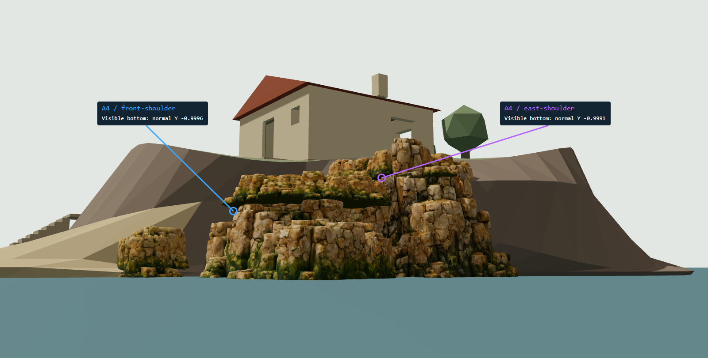

# G01 几何诊断：海岸底面外露与地形衔接

2026-10-30；分支 `codex/m2-2-coastal-assembly`；进入时 HEAD `dde2c71`，工作树干净。已读取 PLAN、G01 审查门、M2.2 handoff/RESULTS、空间合同及三个指定 Three.js Skills。**仅完成 G01；未进行 G02，等待人工审图。**

## 结论（供审图）

1. 最明显的长条悬挑是 **A4 / `front-shoulder`**；第二处是 **A4 / `east-shoulder`**。通过实例轮廓、原材质侧视/低视图和可见三角面的实际命中确认，未先凭 AABB 指认资产。
2. 两者最低实际顶点 Y=**1.852375 / 2.622639 m**。`front-shoulder` 中心没有原地形射线命中，旧检查依赖相邻岩块；局部底面到 A2 支撑面相隔 **1.841–1.925 m**。局部有嵌入/支撑，不能称整块完全悬空。
3. 底面未倒置：只有正尺度和 Y 轴 yaw；低视图看见近似水平的闭合底盖，主视图主要看见朝外且向下倾斜的唇缘。原因是宽而薄的 A4 抬高后，外缘轮廓超出地形/下层岩块；中心支撑不能保证外缘接触。
4. 五实例当前 10k 网格均无焊接后开放边/非流形边；没有发现可以归因为模型开放洞的证据。**摆放、缩放、岩石/地形材质、原 GLB 和地形均未修改**；G01 关闭后的 Golden 与进入时原图视觉一致，最终留存 PNG 字节相同（详见 imageComparison）；一次中间重拍曾有 4 个像素出现 1/255 差异，不推广为跨运行/跨 GPU 完全一致。

## 固定截图与复现



圆圈来自原场景第一命中的三角面中心投影；不是根据照片猜测的标记。蓝色 `front-shoulder` 所标底面法线 Y=-0.9996，紫色 `east-shoulder` 为 -0.9991。标注只覆盖输出 PNG，不修改场景。

| 视角 | 原材质截图 | 实例 ID / AABB / 轮廓 | 加原地形线框 |
| --- | --- | --- | --- |
| 固定 Golden 主视角 | [golden-off.png](golden-off.png) | [golden-ids.png](golden-ids.png) | [golden-terrain.png](golden-terrain.png) |
| 正东水平侧视 | [side-off.png](side-off.png) | [side-ids.png](side-ids.png) | [side-terrain.png](side-terrain.png) |
| 东北背视 | [back-off.png](back-off.png) | [back-ids.png](back-ids.png) | [back-terrain.png](back-terrain.png) |
| 低于 A4 底面的东南仰视 | [below-off.png](below-off.png) | [below-ids.png](below-ids.png) | [below-terrain.png](below-terrain.png) |

12 张原始视图 + 1 张底面标注图；进入时的 [00-original-golden.png](00-original-golden.png) 另行保留。[相机、可见面像素、验证和保护哈希](browser-checks.json)、[实际几何与全部支撑样本](geometry.json)、[编辑前运行记录](original-runtime.json)。

```powershell
$env:PLAYWRIGHT_BROWSER_PATH = 'C:/Program Files/Google/Chrome/Application/chrome.exe'
npm run build
npm run evidence:coastal:g01
# Playwright 自动启动 production preview，截图覆盖本 G01 文件夹。
npm run dev
```

手工入口：[G01 低视图](http://127.0.0.1:5173/?scene=coastal-assembly&diagnostic=g01&diagnosticView=below&overlay=ids)。`diagnosticView=golden|side|back|below`；`overlay=off|ids|terrain`。`diagnostic=g01` 才创建诊断层；默认 `overlay=off`。不加 diagnostic 参数时维持普通实验界面。G01 使用专用下拉框选固定相机，常规拖拽/滚轮不驱动固定相机。

所有证据为 **canvas 1600×811、DPR=1、10k/1K**；浏览器窗口 1600×1100，通过测试样式锁定 canvas，避免新增控件改变投影宽高比。原图窗口 1600×1000，但 canvas 同为 1600×811。无动画，等待实际加载与一次完成渲染的信号后截图。灯光完全沿用原 Hemisphere/Sun/Fill 和曝光=1。

相机设置放在 `public/assets/presets/coastal-g01.json`，没有改 coastal-assembly placement 预设。单位 m，+Y up，+X 东，+Z 南；相机位置/目标为世界坐标。Golden 保留原 target=[0,3.4,3]、yaw=35°、向下俯角=42°、三维距离=40m、FOV=35°，其 position 由原 orbit 公式精确计算。Side position=[30,2.8,3] → target=[8,2.8,3]；Back=[21,6,-16] → [8,2,2]；Below=[22,0.3,12] → [8.5,2.8,2.5]。Below 是海面之上、A4 底面之下，不是穿入海底的视图。仅固定诊断相机绕开交互 pitch clamp，未更改普通相机约束。

## 实例、实际变换与支撑

锚点是导出时包围盒底部中心，**不保证是有几何的真实脚点**。以下最低点从所有实际顶点乘完整 mesh.matrixWorld 取得；先 updateMatrixWorld，不把局部 min 或宽松 AABB 角点当成真实顶点。完整矩阵、精确顶点范围和局部 +Z 的世界方向在 geometry.json。

| instance / asset | 锚点 XYZ m | yaw / scale XYZ | 最低实际顶点 XYZ m | 中心原地形顶面 Y / 含相邻模块顶面 Y |
| --- | --- | --- | --- | --- |
| east-cliff / A1 | 9.5,-0.16,0.8 | 15° / 1,1.2,0.95 | 11.756487,-0.159505,2.560584 | 3.458263 / 3.458263 |
| front-wall / A2 | 8.9,-0.15,4.5 | -5° / 1.15,1.2,0.95 | 5.694664,-0.139790,5.014656 | 无命中 / 2.531181 |
| cove-turn / A3 | 5.6,-0.15,6.4 | -35° / 1.1,1.15,0.95 | 3.373198,-0.148641,7.627806 | 3.074435 / 3.074435 |
| east-shoulder / A4 | 8.9,2.62,1 | 15° / 1,1,0.95 | 8.403049,2.622639,3.137560 | 3.561101 / 3.561101 |
| front-shoulder / A4 | 8.6,1.85,4.2 | -20° / 1.05,0.9,0.95 | 6.918320,1.852375,5.648278 | 无命中 / 2.227093 |

中心两列从 Y=20 向下的第一顶面命中；**顶面高于锚点不是实际底面接触证明**。原模型经标准 glTF Y-up 加载，没有追加 Blender Z-up 旋转；loader 的父节点变换也纳入实际顶点测量。没有负缩放、绕 X/Z 翻转或镜像。

## 具体问题实例和原因

**P01 — front-shoulder / A4，最明显的长板底露与悬挑。** 低视图中蓝色轮廓覆盖中部横向薄台地。范围 Y=1.852375…2.769844m，XZ 为 X=5.957051…11.160823、Z=1.642831…6.343133。底面样本 [10.044386,1.854619,6.271727] 下方原地形没有命中，A2/front-wall 顶面为 -0.070528m，间隙 1.925147m；另一处 [7.809298,1.867802,6.262173] 支撑 Y=0.026873，间隙 1.840929m。这里从上方和从底面出发得到同一 A2 顶面，未把处于相邻体内部的背面剔除误报为无支撑。海面 Y=0 是背景水面，不计岩体支撑。原因：薄底盖被抬高为肩部，下层 A2 的不规则高点只接住局部，外缘跨出地形/岩体轮廓；旧中心检查由相邻模块命中而通过。

**P02 — east-shoulder / A4，上层东侧盖板的底缘和缺接触。** 紫色轮廓是第二块 A4，不是高耸的 A1。范围 Y=2.622639…3.642048m，XZ 为 X=6.366780…11.426979、Z=-1.326671…3.247336。中心原地形顶面 Y=3.561101，局部有嵌入；外缘底面 [11.400789,2.627644,1.694017] 处原地形无命中，A1/east-cliff 顶面 Y=1.964776，间隙 0.662868m。另一向下倾斜边面 [9.012739,3.086821,2.731878] 对 front-shoulder 顶面 Y=2.171664，相隔 0.915157m，原地形仅 Y=0.895087。原因：A4 宽约 5m、厚约 1m，悬出原坡面与 A1 外轮廓；顶部和中心嵌入掩盖了外缘底盖。该实例不是整块漂浮。

**P03 — east-cliff / A1，外侧块状崖体与上层盖板/原地形轮廓不同。** 红色高块是 A1。最低点低于海面，不能把它当作整个上层底露的来源。侧视可见其侧面自身凸凹和内部小悬挑；低视的一个近水平向下三角面位于 [11.678966,1.472235,0.937696]，像素 [1069.720,497.353]。它是局部岩块下沿，尺度与 P01 的长底盖不同。原地形中心相交，但外面轮廓独立，A4 接口仍未连续。

**P04 — front-wall / A2 与 cove-turn / A3，下层体外挂/交界。** 两者实际最低点均约 -0.14m，原图中贴海，未看到像 A4 一样整体抬高的底板。A2 中心没有原地形命中，其“中心支撑”也来自相邻模块；侧视/背视显示作为独立厚岩团贴在岸外，不是连续替代原崖壁。A3 内侧大量被原岩体/海滩遮挡，Golden 中主要露出一个小外块；背视被原地形遮挡，不能凭背视看不到就宣称无接缝。它们参与 P01 下部轮廓错配，本轮不建议先修它们。

## 哪一面朝镜头：可见面与拓扑证据

所有可见性查询都排除隐藏的 cutaway 节点和诊断层，使用原场景第一命中核对三角面中心（0.02m 容差），再投影到 PNG 像素。下面是稀疏采样数，**不是可见面积或全部底面的数量**。

| instance | 主视向下倾斜面 nY<-0.35 / 近水平底面 nY<-0.9 | 水平侧视近水平底面 | 低视近水平底面 |
| --- | --- | --- | --- |
| east-cliff | 11 / 0 | 0 | 1 |
| front-wall | 14 / 0 | 0 | 0 |
| cove-turn | 1 / 0 | 0 | 0 |
| east-shoulder | 15 / 0 | 9 | 15 |
| front-shoulder | 21 / 0 | 7 | 80 |

主视镜头在 east-shoulder 实例局部约 [0.026,0.688,0.725] 方向，即局部 +Z、上方；front-shoulder 为 [0.376,0.784,0.495]，即 +X/+Z、上方。低视分别约 [0.549,-0.130,0.826] / [0.974,-0.115,0.194]，低于底面，可直接看到 −Y 底盖。+Z 只是模型局部轴，源资产没有可验证的“美术正面”标签，故不宣称 yaw 选错。主图里的暗边不能统称水平底面翻向天空；侧/低视才确认实际底盖外露。

五实例在 1e-5m 顶点位置焊接容差下，开放边=0、非流形边=0，与已有 10k LOD 拓扑审计一致；未做昂贵的自交/内部壳体布尔分析。现有证据支持“闭合底盖外露 + 局部轮廓缺接触”，不支持先修改 normals、doubleSide、材质来掩盖问题。

## 可视化辅助与限制

诊断层含实例 ID、世界对齐 RGB 轴、底部中心锚点、最低实际顶点球、精确 AABB、随相机变化的三角面朝向轮廓，以及只读原地形的独立线框代理。地形线框在 `terrain` 模式启用，原地形仍保持原材质和遮挡。线框、AABB 和轮廓允许显示被遮挡的界面；看到这些线不等于看到实际裸露的岩面，必须与 off 图一起看。标签为防重叠会向上错开，具体位置以对应标记和 geometry.json 为准。

支撑样本取 nY<-0.35 三角面中心，每 0.25m XZ 单元保留一个，分别从上方和底部射线检查；有原地形/其他模块顶面高于样本时不标成暴露候选，避免内部重叠被背面剔除误报。射线、阈值焊接与 AABB 是辅助，不代替截图或严格体积接触测试；斜向接触、极窄裂缝及自交仍可能漏检。诊断运算成本不作为生产性能指标；本轮未进行真机或长时间 GPU 测试。

旧 canvas.worldBounds / validation.json 用 Box3 默认路径，会旋转局部盒角得到偏宽保守范围。本次 helpers / geometry.json 遍历实际变换顶点，范围更紧；这是测量方法变化，**没有移动模型**。例如 east-shoulder 实际 X 范围为 6.3668…11.4270，旧报告为 6.0030…11.7982。

## 验证、改动与停止点

| 检查 | 结果 |
| --- | --- |
| strict typecheck / production build | 通过；保留既有共享 Three.js chunk >500kB 提示 |
| lint | 通过 |
| unit | 4 文件 / 32 项通过 |
| G01 对应浏览器测试 | 1 项通过：12 固定截图、可见底面证明、五实例矩阵不变、开关/卸载/重建、默认关闭、原地形/摆放/8 份 LOD 哈希不变 |
| console / failed requests / HTTP >=400 | 全部为空；Chrome 156.0.8078.74，WebGL2，桌面 NVIDIA RTX 3070 Ti/ANGLE D3D11（编辑前运行记录） |
| 修改前 vs G01-off Golden | 最终两个 PNG SHA 均为 `f71ad278ee710dd90e285dfc09eb0266738dc1c8838e90e230d7723665388546`，1,297,600 像素中差异 0；中间一次重拍曾有 4 个像素差异、最大单通道差 1/255，未见几何或材质变化；最终数据以 browser-checks.json.imageComparison 为准，不作跨 GPU 精确像素合同 |
| 全量旧 browser / 全资产再生成 | 未运行；按逐关最小检查要求，本轮只跑 G01 与已有 unit/lint/build；未再生成任何资产 |

开发时首轮 G01 浏览器检查曾失败：GLTF 命名节点 `Organic_Coastal_Mass` 实为 Group，而非直接 Mesh。诊断代码改为递归读取实际子 Mesh，随后通过。未因失败更改地形或材质。

改动文件：`src/world/coastalDiagnostics.ts`（只读测量/辅助层）、`src/app/CoastalApplication.ts`（隔离 G01 入口与生命周期）、`src/style.css`（诊断标签）、`public/assets/presets/coastal-g01.json`（独立固定相机）、`tests/browser/coastal-g01.spec.ts`（截图/保护验证）、`package.json`（复现命令）、`README.md`（入口）、本目录报告/PNG/JSON。`src/world/coastal.ts`、`coastal-assembly.json`、M2.1 模型/参数/碰撞和岩石材质未改动。

**下一关提案，仅供人工决定：G02 首选 front-shoulder / A4 单实例**，用相同 Golden/侧/低视做最小 placement 参数实验，观察是否能同时改善长底盖和顶部衔接。若简单变换无法同时满足，按 G02 提出裁切或过渡几何的两种备选并等待选择。**本 commit 到此停止，不执行该实验、不自动进入 G02、不合并或推送分支。**
