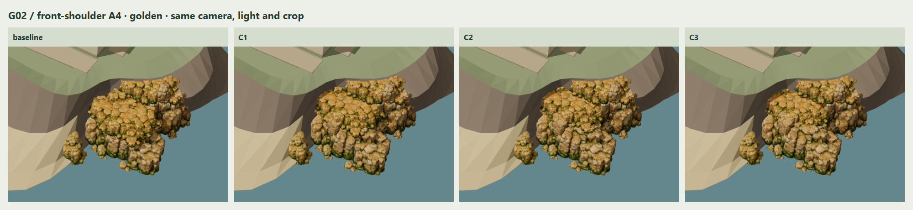
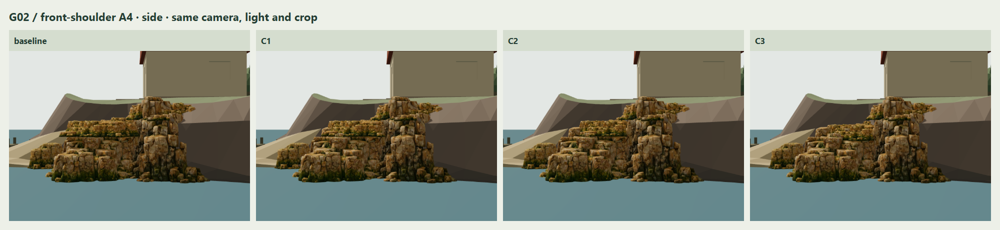
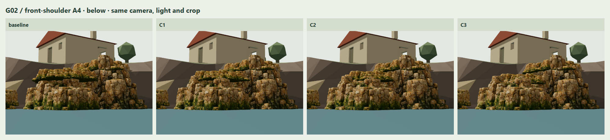

# G02：front-shoulder / A4 三个 placement 候选

2026-10-30。分支 `codex/m2-2-coastal-assembly`，从 G01 commit `382401c` 开始，进入时工作树干净。已读取 PLAN、逐关规则、G01 诊断报告、空间合同和三个 Three.js Skills。**本轮只有候选实验，默认摆放仍为 G01 原值；等待人工选择，不进入 G03。**

## 结论（供人工选择）

1. 仅改变 `front-shoulder / A4` 的 position / yaw；三个候选的 scale、材质、原始 GLB 均保持不变，其他四个实例和原地形未改动。
2. C1 仅水平内收；C2 内收加 12° yaw、保持原高度；C3 在 C2 上下移 0.20m。低视底盖估算外露面积分别减少约 **56%、80%、95%**，因此内收/旋转本身已经有效，不把下移当作验收依据。
3. **C2 是相对平衡的 placement 参考，但没有达到完整视觉验收**：低视仍有约 900px 底盖，局部间隙仍达 1.581m；顶部台地仍与原坡面/上层岩块形成层状接口。C1 的局部最大间隙甚至增大。
4. C3 底面遮挡更充分，但肩部顶面降低 0.20m、原地形吞入更多顶部，不能因剩余底盖小就判为最佳。三个小变换均未同时解决上下衔接；报告末尾给出 **Blender 裁切**和**独立过渡几何**两条路线，均未实施。

## 候选参数与保护边界

完整参数：[coastal-g02.json](../../../../public/assets/presets/coastal-g02.json)。单位 m、Three.js +Y up；position 是原导出底部中心锚点，yaw 绕 +Y。所有候选的 scale 均为原值 [1.05,0.9,0.95]，tint、embeddingM、asset ID 直接继承原 placement，没有新的材质或 GLB。

| 方案 | position XYZ | 相对原位置 ΔXYZ | yaw / Δyaw | 目的 |
| --- | --- | --- | --- | --- |
| G01 原摆放 | [8.6,1.85,4.2] | [0,0,0] | -20° / 0° | 对照，不计为新候选 |
| C1 水平内收 | [8.15,1.85,3.55] | [-0.45,0,-0.65] | -20° / 0° | 隔离水平嵌入的作用 |
| C2 内收并旋转 | [7.95,1.85,3.35] | [-0.65,0,-0.85] | -8° / +12° | 收回底盖、调整悬挑方向，保留顶部高度 |
| C3 内收旋转加降高 | [7.95,1.65,3.35] | [-0.65,-0.20,-0.85] | -8° / +12° | 对照额外降高的收益和顶部代价 |

配置验证限制：最多三个候选，只能替换 front-shoulder/A4；水平位移≤1.2m、垂直≤0.25m、yaw≤15°、scale 相对变化≤5%。本轮水平位移最大 1.070m，没有缩放实验。越界、额外材质字段、错误资产或重复候选 ID 会拒绝加载。

G02 路由显式选择候选后才应用内存中的 placement 覆盖。`public/assets/presets/coastal-assembly.json` 原值未改，不加 `diagnostic=g02` 即使 URL 带 `candidate=C3` 也不会应用候选。其他四实例实际 world matrix、实际顶点 bounds 在每个候选中完全一致。G01 固定相机预设、原地形/房屋/地下室参数和模型、楼梯/码头结构保持字节/规范化文本哈希一致；四份原始源 GLB 和八份 LOD 哈希全部与 manifest 一致。

## 固定 Golden / 侧 / 低视截图

所有原图采用 G01 的**同一 camera position/target/FOV、灯光/曝光、1600×811 canvas、DPR=1、10k/1K**。没有动画；等待资产完成和真实渲染完成信号，未通过改变相机或视口隐藏缺陷。近景对照只是对完整 PNG 使用相同裁剪，不另设近景相机。

| 方案 | Golden 全景 | 正东水平侧视 | 东南低视 | 低视底盖采样标记 |
| --- | --- | --- | --- | --- |
| 原摆放 | [baseline-golden.png](baseline-golden.png) | [baseline-side.png](baseline-side.png) | [baseline-below.png](baseline-below.png) | [baseline-below-mask.png](baseline-below-mask.png) |
| C1 | [C1-golden.png](C1-golden.png) | [C1-side.png](C1-side.png) | [C1-below.png](C1-below.png) | [C1-below-mask.png](C1-below-mask.png) |
| C2 | [C2-golden.png](C2-golden.png) | [C2-side.png](C2-side.png) | [C2-below.png](C2-below.png) | [C2-below-mask.png](C2-below-mask.png) |
| C3 | [C3-golden.png](C3-golden.png) | [C3-side.png](C3-side.png) | [C3-below.png](C3-below.png) | [C3-below-mask.png](C3-below-mask.png) |







三个对照从左到右为原摆放、C1、C2、C3；其共同 crop 为 Golden=[740,420,540,370]、Side=[430,290,740,350]、Below=[350,300,850,350]，格式 x/y/w/h，单位源图像素。完整 Golden 图保留全海岸轮廓供审查，局部裁剪不能代替整体判读。

## 底面面积、间隙与顶部衔接比较

| 指标 | 原摆放 | C1 | C2 | C3 |
| --- | ---: | ---: | ---: | ---: |
| 低视可见近水平底盖估算 px | 4608 | 2016 | 900 | 252 |
| 相比原摆放减少 | — | 56.25% | 80.47% | 94.53% |
| 底盖占当前实例可见估算面积 | 20.29% | 13.30% | 7.18% | 3.08% |
| 低视所有下向面估算 px（含斜唇缘） | 4932 | 2196 | 1332 | 396 |
| 有限悬挑样本间隙中位数 m | 0.644 | 0.336 | 0.296 | 0.363 |
| 有限悬挑样本间隙 P95 m | 1.617 | 1.181 | 1.125 | 0.937 |
| 有限悬挑样本最大间隙 m | 1.925 | 2.167 | 1.581 | 1.381 |
| 底部最低实际顶点 Y m | 1.852375 | 1.852375 | 1.852375 | 1.652375 |
| 顶部最高实际顶点 Y m | 2.769844 | 2.769844 | 2.769844 | 2.569844 |
| 顶面与原地形高程相差≤0.10m 的采样数 | 5 / 291 | 2 / 295 | 1 / 298 | 1 / 298 |
| 顶面低于原地形超过 0.10m 的采样数 | 37 | 101 | 123 | 124 |

面积是**可见投影估算**：在每张图相同绝对 6×6px 网格上，向原场景射线，第一命中必须是 front-shoulder，再用实际世界几何法线分类；近水平底盖 nY<-0.9，下向面 nY<-0.35。粉色方块只覆盖导出的 PNG，没有更改模型材质。不是精确 GPU 光栅面积，不代表体积或世界接触面积。

主视和水平侧视的近水平底盖估算均为 0，因为薄边容易落在 6px 网格间隙；**不能以此宣称它们没有底露**。G01 的三角面中心证据已确认侧视存在细薄底面，本轮以同机低视面积、实际间隙和全部原材质图共同判断。顶部采样只比较高程，不证明贴合、可行走或连续拓扑。

间隙来自实际下向三角面的 0.25m XZ 单元样本，排除原地形/相邻模块顶面高于样本的重叠候选，再取向下第一支撑命中。包含向下斜面，不仅水平底盖；null 支撑不当成零。不同水平位移/旋转会改变单元代表样本和支撑形状，分位数只能辅助比较，不能证明整面最大空隙。C3 下移后一些小间隙样本被嵌入并从候选集合排除，所以剩余集合的中位数反而略高，不意味着同一位置的间隙增大。C2/C3 相同 XZ 和 yaw，故同一边缘点的高程差可以直接比对。

具体残余问题：

- **C1**：原来长板的一部分收进 A2/原坡面，Golden 更紧凑；低视还保留长横向下缘。新向下斜面样本 [10.259873,2.263576,3.015003] 对 A2 顶面 Y=0.096944，相隔 **2.166633m**，比原最大片段更高。这里不能只看总体底盖面积下降。
- **C2**：低视横向底盖大幅缩短，Golden 的肩部相对紧凑，保留原顶部高度；但粉色残留显示中右段仍有底盖。实际近水平底部样本 [10.143163,1.864868,2.944493] 下方 A2 顶面 Y=0.283929，间隙 **1.580939m**，原地形该列没有命中。顶部内侧大幅嵌入原岩体，外侧仍高于低岸：这是轮廓错配，不是已闭合的自然台地接缝。
- **C3**：同一个 XZ 点底面降为 Y=1.664868，间隙 **1.380939m**，减少的恰为 0.20m；仍未填实。Golden/低视看到肩部更深陷入下层岩团、原横向顶缘变低，与固定的 east-shoulder 更呈阶差。底盖面积最小不能抵消这个顶部代价。

原地形沿坡面从高台地（约 Y=3.8m）快速降至低岸，同一块约 5m 宽、约 0.92m 厚的 A4 底盖保持大致平面。内收让部分顶部埋入更高地形，但外缘仍跨越 A2 的低谷；降高遮住底盖，却同时降低整块顶部。整体海岸仍是装饰岩团附着于原白模崖壁，台地边界、上层 A4 悬挑和材质界限仍在（其他实例/材质本轮受保护）。本轮三个小范围变换**未能同时完成上下衔接**；没有声称穷举所有可能变换或所有视角。

## 若继续：两种未实施的几何方案

| 路线 | 具体做法（需人工选择后另行授权） | 收益 | 代价 / 需要验证 |
| --- | --- | --- | --- |
| A：Blender 裁切 front-shoulder 的派生副本 | 复制原 A4，只为 front-shoulder 生成独立派生资产；按 C2 残余底盖和原坡面/下层 A2 交界裁短/裁斜外缘，封闭切口并保留可用顶面。原始 GLB 只读，另一个 A4 实例继续用原资产 | 能独立改变底轮廓而保留顶部高程，直接去除水平长底盖 | 需要封口、UV/法线和纹理检查；过度裁切会造成薄片或失去体积；新增导出/命名/manifest 合同需明确，不能原地覆盖共享 A4 |
| B：独立局部过渡几何 | 在 front-shoulder 交界增加可关闭的装饰过渡片/斜楔；内侧接原台地边缘，外侧接 A4 顶缘，下侧延伸到 A2 支撑轮廓。保留原地形和所有碰撞/导航；不是重建全岛 | 保留原 GLB，可同时提供顶面薄过渡与底部局部支撑形体 | 需要采样实际边界并控制交叠/z-fighting、可见轮廓和材质过渡；可能增加“补丁/砌墙”感，不能靠一整块遮挡所有问题 |

当前三个候选未应用为默认修复；如果人工选择继续 placement 路线，**C2 可作后续比较基准**，仍需审图。以上 A/B 均只有方案说明，未打开 Blender 裁切、未生成新 GLB、未添加过渡 mesh。

## 复现、验证和交付

```powershell
$env:PLAYWRIGHT_BROWSER_PATH = 'C:/Program Files/Google/Chrome/Application/chrome.exe'
npm run build
npm run evidence:coastal:g02
# Playwright 自动启动 production preview，生成本目录证据。
npm run dev
```

手工入口：[G02 / C2 / Golden](http://127.0.0.1:5173/?scene=coastal-assembly&diagnostic=g02&candidate=C2&diagnosticView=golden&overlay=off)。候选下拉框可选原摆放/C1/C2/C3；`diagnosticView=golden|side|below` 沿用 G01 固定相机。诊断 overlay 默认关闭；G01 入口及普通 M2.2/M2.1 入口保留。

证据：[measurements.json](measurements.json)，记录三视图面积估算、顶部样本、实际矩阵/界限、局部间隙、原始/运行时资产和保护文件 SHA。**12 张完整原材质 PNG、4 张底盖标记 PNG、3 张同 crop 对照 PNG**。没有第四候选，原摆放仅作 before 对照。

| 检查 | 结果 |
| --- | --- |
| strict typecheck / build | 通过；保留既有 Three.js 共用 chunk >500kB 提示 |
| lint | 通过 |
| unit | 5 文件 / 35 项通过（含 3 项 G02 范围保护） |
| G02 browser | 1 项通过，覆盖原摆放和三个候选各三视图、其他实例矩阵/bounds 不变、默认入口不应用候选、参数/GLB 哈希与建筑/地下室/楼梯/码头保护体检查 |
| console / failed requests / HTTP >=400 | 均为空；桌面 Chrome 156.0.8078.74 / WebGL2 |
| 全量旧 browser / 真机 / 长时间 GPU / Blender 再生成 | 未运行；按逐关最小验证，本轮不做最终整体验收或资产再生成 |

改动文件：`public/assets/presets/coastal-g02.json`（三个候选）、`src/config/coastalReview.ts`（限制和单实例覆盖）、`src/app/CoastalApplication.ts`（隔离 G02 选择入口）、`src/world/coastalDiagnostics.ts`（只读面积/顶面测量）、`tests/unit/coastal-review.test.ts`、`tests/browser/coastal-g02.spec.ts`、`package.json`、`README.md`、本目录 PNG/JSON/报告。原 placement、原地形、GLB、材质和其他四实例未编辑。

**本轮到此停止，提交独立 G02 commit，等待人工选择候选或 A/B 几何路线；不自动执行任何路线、不进入 G03、不合并或推送。**
