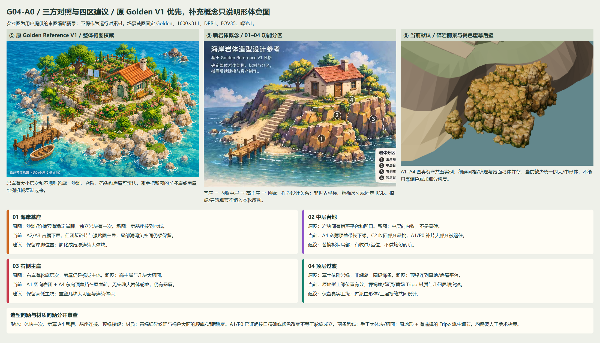

# G04-A0 — 海岸岩体结构分析与制作方案（等待审图）

2026-11-02；分支 `codex/m2-2-coastal-assembly`；起点 `15c4efb`。**本轮只有分析、图片标注与方案，没有正式建模。** 建议下一次先试一块能在 Golden 全景直接看见的前景基座，用人工确定大形；现有地形作为空间约束，Tripo 可作为择取的参考/细节来源，不再默认让它们承担整个主崖。

## 两张实际参考图及优先级

两张文件均已实际读取、查看，都是 1536×1024，未重命名或覆盖：

| 参考 | 实际仓库相对路径 | 用途 |
| --- | --- | --- |
| 原 Golden Reference V1 | `docs/references/golden-reference-v1.png` | 整体构图、比例、岛岸轮廓和颜色关系的权威 |
| 新海岸岩体造型图 | `docs/references/20261102195825_187_18.jpg` | 图内标题“海岸岩体造型设计参考”；对应交接文档的 `coastal-rock-structure-reference-v1` 概念，不是同名文件 |

完整文件哈希与尺寸：[references.json](references.json)。原图 SHA 与 `GOLDEN_REFERENCE_V1.md` 一致，新图 SHA 为 `21b1639089390b7e2d5945a9fecadff4c333090c804fd10759ba0392fcf8cf16`。原文件只留在用户本地，独立提交只含本次请求的审图摘录/标注，不把参考图用作运行时素材。

原图岩岸有大小不一、略圆润的非对称岩块，保留独立礁石、沙滩和入口的负空间；房屋是主体。新图将岩岸解释成基座、内收中层、高主崖和顶缘，切面更强、竖向层次更明显。可借用其大/中体块关系与明暗面；**不能机械复制整圈柱状崖、房屋比例、额外台阶、植被或 RGB**。原图的一层房屋加隐藏地下室、岛屿面积与已批准通路仍优先。

## 四区映射与问题



| 功能区 | 当前覆盖 | 形体/连接问题 | 材质问题与建议 |
| --- | --- | --- | --- |
| 01 海岸基座 | A2 `front-wall` + A3 `cove-turn`，原砂岸/崖脚 | A2/A3 最低顶点已低于水面，不足以证明整个脚部接地；外形仍读作碎岩团。A3 与主体间的空隙有时读成独立岩柱。应设计宽厚支撑与海湾开口，少量独立礁石可以保留，不能让它们承担主崖支撑 | 黄绿碎石/苔藓频率偏高。保留岸脚和沙滩关系，简化为少量连续大体块，再按面组织暖主体/冷阴影 |
| 02 中层台地 | 前肩 A4，A2/A1 上部与原坡面 | A4 宽约 4.8m、高约 1m，抬高后形成薄顶盖/下唇。C2 收回部分底盖，未同时解决上下衔接。应有非等距内收、凹口和次体块，不做均匀叠砖；这里是视觉台地，不能新增行走面 | 细碎纹理不能修复板状轮廓；建议替换可见肩部大形，原 A4 留档/供参考，土石过渡另审 |
| 03 右侧主崖 | A1 `east-cliff` + 东肩 A4，背后原 `Organic_Coastal_Mass_1` | A1 的竖向团簇与 A4 的横向顶盖叠在褐色崖幕后壁前，缺少从底到顶统一的主块。东肩仍有悬唇；应由少数大切面组织最高沿岸体块，维持低岸→中层→主崖的主次 | 黄绿碎纹理与褐色大面跳变。保留高度/体积包络作为参考，重塑主块；不把 A1 原纹理或更多细分视作风格答案 |
| 04 顶层过渡 | 原 land `_2` / cliff `_1` 共边，两个 A4 肩部附近 | 地形上缘位置有效，局部 A0 真边界已验收；但外接肩部不自然。应设计连续土层厚度、岩顶折面与接入原顶面的坡度，避免新增垂直端盖、整圈绿带或悬空台沿 | 绿顶/褐崖/黄岩的色块关系仍割裂。先解决几何折面与接缝，再审少量亮顶/暖面/冷面；此轮不重做材质 |

四区是相互重叠的**造型职责**，不是四个互斥网格，也不是把概念板编号直接转换成坐标。标注：[Golden](mapping-golden.png)、[Golden-close](mapping-golden-close.png)、[side](mapping-side.png)、[below](mapping-below.png)。虚线为实际顶点 world AABB 的投影包络，包含被遮挡部分，**不是可见轮廓或精确分区边界**；编号是人工选定的功能区锚点。青线只绘出已验收 A0 的局部 T。

Golden 最能判断岸线、房屋与沙滩的关系；close 能辨认碎岩、板状中层和材质交界。side/below 确认中层水平唇缘和层叠结构，低视不能靠海水遮住下缘就视作衔接通过。原图允许有目的的独立礁石；当前问题是缺少主块层级，不能因此把所有散石一律删除。

## 现有资产与保留策略

原岛体外表面中 cliff `_1` 为 604 面、land `_2` 为 296 面、sand `_3` 为 79 面、楼梯材质网格 `_4` 为 229 面；是空间/碰撞查询依据，不重建。原外崖全岛 Y 包络约 −0.32～4.37m，不是本次前岸局部高度。五个原岸石占位体各 20 面，拼装入口只按既有设置隐藏 `Coastal_Rock_Visual_02/03`，其余不动。

Tripo 是 **四类资产、五实例**。源文件各约 188–199 万面，已有 10k/1K、20k/2K LOD；本次截图用 10k，每实例 10,000 面，五实例合计 50,000 面。再降面不会自动去掉烘在纹理里的碎石/苔藓，也不会自动设计轮廓。

| 实例 / 资产 | 默认 position XYZ；yaw；scale XYZ | 实际顶点 Y 范围 m | 建议（未执行） |
| --- | --- | --- | --- |
| east-cliff / A1 | `[9.5,-0.16,0.8]`；15°；`[1,1.2,0.95]` | −0.160～3.774 | 保留源文件、竖向比例和底部空间参考；可见主块重塑/重拓扑，避免原碎岩纹理继续主导 |
| front-wall / A2 | `[8.9,-0.15,4.5]`；−5°；`[1.15,1.2,0.95]` | −0.140～2.346 | 保留基座落位和岸线关系；优先试作一块宽面基座，窗口以外原表面保留 |
| cove-turn / A3 | `[5.6,-0.15,6.4]`；−35°；`[1.1,1.15,0.95]` | −0.149～2.464 | 保留海湾转角/通路间隔；简化小岩团，可择取一处有意义的孤石，逐块检查接地 |
| east-shoulder / A4 | `[8.9,2.62,1]`；15°；`[1,1,0.95]` | 2.623～3.642 | 将可见薄盖建议替换为接入主崖的次体块；共享 A4 源不能覆盖 |
| front-shoulder / A4 | `[8.6,1.85,4.2]`；−20°；`[1.05,0.9,0.95]` | 1.852～2.770 | 建议重设计中层肩部；C2 为 `[7.95,1.85,3.35]`、−8°，高度/scale 不变，保留作工程对照 |

资产的“保留”包括归档、比较与派生参考，不意味着强制在最终主崖上显示。简化/裁切/重塑都只针对另存派生副本；原 Tripo、共享 A4、manifest 和默认场景不覆盖。若未来隐藏某个实例，必须有局部替代且控制被露出的原表面，不能隐藏整片后留下空洞。

现有变体保留：G01 原摆放为当前默认；G02 C1/C2/C3 只改前肩变换，C2 并非已写入默认；G021 是原陡坡渲染副本局部融合；G022 是前肩渲染副本拉高/局部替换与顶缘 apron；G03-A0 只有真实边界；G03-A1 是真实剖面连续片；G03-P0 是相同片的六区配色。后两者是部分/负面对照，**不是最终艺术目标**。四视角现存变体对照：[Golden](variants-golden.png)、[close](variants-golden-close.png)、[side](variants-side.png)、[below](variants-below.png)。默认/C2 五实例可见，A1/P0 只隐藏前肩 A4，因此不能把其中可见性差异当作配色收益。

## 两条制作路线

| | 路线 A：人工大形 / 低面数手塑 | 路线 B：原地形 + 择取的 Tripo 派生层 |
| --- | --- | --- |
| 过程 | 人工画默认 Golden 的主轮廓和大面方向；在真实地形约束旁手塑一块宽厚主岩体，切出几个不等大的斜面/凹口；必要时 Blender 编辑，另存源/GLB；轮廓通过后按受光面设计色值 | 保留原岛体作连续支撑，挑 A2 或 A1 中确有价值的大转折；另存裁切、手工合并/重拓扑，删去无意义小块；仅在少量位置放派生细节；主形仍由人工控制 |
| 人工投入 | 必须决定岩块主次、外沿曲线、切面法线、土层过渡和阴影形状；不是“程序生成几列岩石” | 必须选择片段、去掉薄盖/碎结构、整理法线/UV、确定哪里需要保留纹理；不能把 Decimate 或自动裁切当艺术指导 |
| 收益 | 最容易控制整体轮廓、宽面尺度和统一风格；可避免被原纹理/薄板轮廓绑住 | 利用已存在的尺度、空间参照和局部有机转折，保留少量原图需要的个性化岩石 |
| 限制 | 有明确手工建模/美术成本；过度简化也会变成光滑幕布或无岩层特征的方块 | 并不保证省工：碎纹理和噪声轮廓容易残留，混合材质跳变仍要另审，细节层不得遮掉主形效果 |
| 当前倾向 | 建议作为单块 A1 小样的主路线，先确定形体 | 作为同一候选范围的备选；如果人工择取后仍像碎石堆，应停止继续拼装 |

两条路线都只使用现有 Three.js 渲染/导出约定，无新引擎、ECS 或 shader 体系。程序可辅助导出、低频变体与验证，**没有证据证明 Blender 程序化建模单独能达到目标**。路线建议等待人工选择，未启动 Blender 或任何资产生成。

## 建模前必须定下的事项

| 决策 | 约束 / 审图重点 |
| --- | --- |
| 主轮廓 | 原 Golden 的不规则岸线优先；前基座较宽、中层内收、右崖较高，不统一复制竖柱/砖阶，不抢房屋主体 |
| 比例 | 房屋宽深 6×6m、楼面 Y=4、地下室楼面 Y=1.2 保持；原岛高台约 Y=3.8、沙岸约 0.45、水面 Y=0。局部实际顶缘按源网格，不能把标称高程强拉到全岸 |
| 接缝 | 明确试验片两端 E、内侧与原岛/相邻岩块的交线；采用实际表面采样/裁分，保留范围外表面，不用垂直端盖封成切墙 |
| 顶层过渡 | 04 草土与岩顶是连续形体职责，不用一圈绿色装饰片遮缝；A4 的近水平底盖不能作为真实草地边界 |
| 水线 | 锁定原海平面；基座应穿过实际 W 并有支撑体积，不能只下移整块遮住悬空。沙滩和码头附近负空间保留 |
| 面与颜色 | 先确定几个大/中切面和克制凹口，再组织亮顶、暖主面、冷侧面；无需噪声、微岩层或新增植被。概念板色卡不是固定 RGB |
| 边界证据适用范围 | G03-A0 的 T/F/W/E0/E1 只覆盖前肩附近约 2.51m 崖顶；F 在 Y=0.12 的近岸脚线、W 在水面。不能把它当全海岸或下面候选的完整边界 |

坐标保持米制 Three.js +Y 上、+X 东、+Z 南，yaw 绕 +Y；GLB 直接读 matrixWorld。后续若手工使用 Blender，保持已有 Z-up→Y-up `(x,y,z)→(x,z,-y)` 导出约定，GLTFLoader 后不重复旋转；继续用原 axis_test 检查，而非按概念板推测坐标。

## 仅提出的 G04-A1 单块候选

[候选窗口标注](candidate-plan.png)：建议 **01 前景基座的一块主岩体**，以 `front-wall/A2` 的前侧可见部分为范围。它在 Golden 直接可见，可先验证大形是否真的改变全景，避免再次只改变岩石后方的小片。搜索窗口约 X=[8.2,11.2]、Z=[5.0,7.2]、Y=[0,2.35]m，目标可见宽约 2.5–3m、约半个房屋宽，不抬高到房屋平台。**这是标注提案，非批准接口或已生成模型。**

人工确认轮廓后，下一轮才允许重新提取窗口处的原地形/A2/水面边界，再做可关闭的派生表面；窗口外 A2 保留，其他四实例不移动，不整块隐藏 A2。若无法在该范围保持衔接，应先报告，不自行扩成整段主崖。两条路线使用相同范围/机位作比较；材质只需少量受控明暗面支撑判读，正式纹理/植被继续后置。

未来 A1 验收标准（本轮未执行）：

1. Golden **未裁剪全景**中能够直接读出宽厚主块和少量大面，沙滩/楼梯/码头关系清楚；若仍主要被旧岩块遮住，或只在局部放大中成立，则试验无效。
2. close 中不读成碎石堆、光滑幕布、重复砖阶或高频逐面乱色；保留有目的的转折、凹口和非对称轮廓。
3. side/below 中两端、内侧和水线不出现新增切面、薄板唇缘、悬空/洞口；接口/拓扑数值作为附加门槛，不能代替艺术判断。
4. 原建筑、地下室、岛 footprint、路径、相机/曝光、碰撞导航和范围外实例保持一致；独立入口可切回默认，并提交相同固定四视角 Before/After。
5. 人工判断整体方向成立，才讨论扩大到 02/03/04 或正式材质；这块基座小样不宣称已修好整岸。

## 证据、验证与交付范围

12 张新拍原始 PNG（默认/C2/A1/P0 × Golden/side/below）、四张默认分区标注、四张现存变体对照、三方参考对照和候选窗口图。原始画布 1600×811、DPR1、10k/1K、FOV35、曝光1，沿用 G01 明确 position/target；Golden-close 固定 crop `[750,430,540,350]`，不改机位。参考摘录仅用于视觉关系比较，不宣称与场景几何或相机一致。

`npm run build`（含 strict typecheck）、lint、22 项相关 unit 和 1 项只读 browser fixture 通过；console/network 无错误。Chrome156/WebGL2/RTX3070Ti；未运行 Blender、资产再生成、真机/性能测试或全量旧 browser。保留原 build 大 chunk 提示。[inventory.json](inventory.json) 包含实际矩阵/顶点 bounds、原地形清单、八份 LOD/四份源 GLB 及 src/预设/既有 G03 证据的保护哈希；两张参考图前后哈希相同。

```powershell
$env:PLAYWRIGHT_BROWSER_PATH = 'C:/Program Files/Google/Chrome/Application/chrome.exe'
npm run build
npx playwright test tests/browser/coastal-g04-a0.spec.ts --output=test-results/g04-a0
```

仅新增本目录报告/图/JSON 和 `tests/browser/coastal-g04-a0.spec.ts`，生产代码、mesh、shader、预设及默认入口无改动。进入时已有的暂存研究文档 `docs/research/2026-11-02-diorama-style.md` 保留其暂存状态，不纳入本次独立提交；新参考 JPG 原文件继续本地保留。

独立 commit/push 后停止等待人工审图。**没有执行 G04-A1。**
