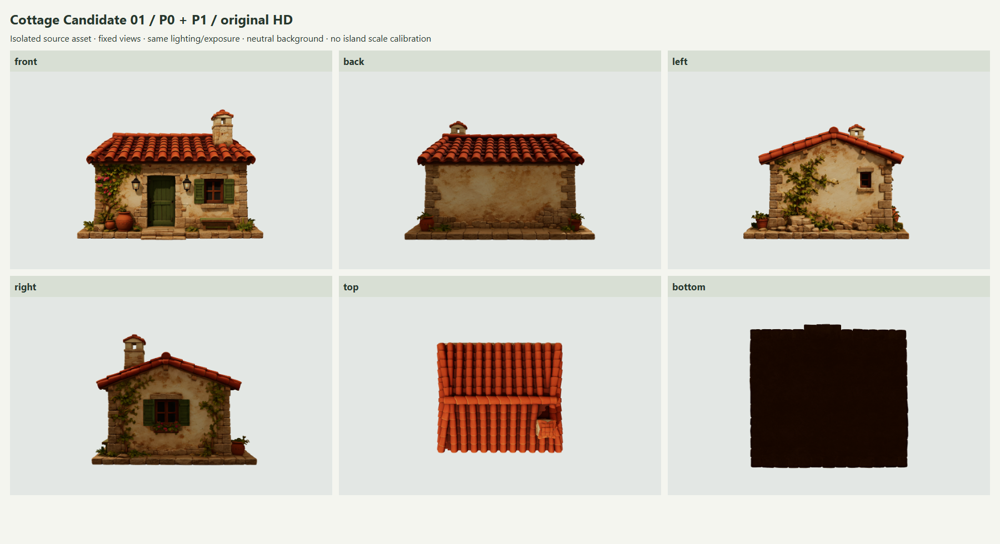

# M2.4 — Tripo Cottage Candidate 01 / P0 + P1

日期：2026-11-03。分支：`codex/m2-4-cottage-tripo-spike`。
检查基线：`6708c4435e4ef6187b1b7b3fc4a13502e6f3efe9`。

**交付状态：P0 静态检查与 P1 独立查看器完成，提交供人工审核。尚未批准进入 P2。**
本轮以用户最新明确的 P0/P1 请求为范围；旧 pivot handoff 的 H01-only 停止点是历史约定。海岸工作继续冻结，旧报告和实验保留。

候选外观具有单层地中海小屋特征；四面、两坡瓦顶、烟囱和底座均可观察，贴图正常。矩形门框、带瓦盖的烟囱、更密且偏暗的旧化纹理与 Golden V1 有差异。是否接受这些差异需人工判断。单独查看模型不能证明其在 Golden 岛屿中的比例、道路连接或地形接触已经通过。

## P0 — 原始资产与实际统计

实际检查文件：`D:/web-hd2d-demo-1/art-source/tripo/inbox/tripo_cottage.glb`。
保留在发现它的约定 inbox，原文件只读，未移动、转换、压缩、重拓扑、重新烘焙或重复导出。

SHA-256：`a7101c0dce3570e9ac6deacf78e0b31ad9a0ac90dbe14501319e9ef93f66b7a4`。

| 项目 | 实测结果 |
| --- | --- |
| 文件 | GLB 2.0，generator `Tripo` |
| 文件大小 | 67,361,380 bytes / 64.240 MiB |
| Scene / Node / Mesh / Primitive | 1 / 1 / 1 / 1 |
| 顶点 | 1,023,693 |
| 三角面 | **1,907,653**，原始 HD 级别 |
| 材质 | 1 个 `MeshStandardMaterial`，FrontSide |
| 几何属性 | POSITION、NORMAL、TEXCOORD_0，索引三角面 |
| 扩展 | 声明 KHR_materials_volume、FB_ngon_encoding；无 required 扩展 |

| 内嵌贴图 | 分辨率 | 编码大小 | 浏览器绑定 |
| --- | --- | --- | --- |
| tripo_cottage_basecolor.jpg | 4096 × 4096 | 4,215,511 bytes | Base Color，sRGB |
| tripo_cottage_rm.jpg | 4096 × 4096 | 2,082,336 bytes | Roughness / Metalness，线性，共享图像源 |
| tripo_cottage_normal.png | 4096 × 4096 | 5,411,527 bytes | Normal，线性 |

三个图像源全部实际解码为 4096 × 4096，材质绑定及颜色空间经过运行时验证，没有缺图、粉色材质或浏览器纹理报错。GLB 未声明 `occlusionTexture`，不能把 packed RM 的 R 通道当作已验证加载的 AO。

### AABB 与坐标语义

检查脚本遍历全部 1,023,693 个实际 POSITION，应用完整场景节点矩阵；浏览器再次计算精确 AABB，与检查数据逐轴核对，容差 1e-6。

| 源坐标数据 | XYZ |
| --- | --- |
| AABB min | [-0.4900970161, 0, -0.4430847168] |
| AABB max | [0.4900970161, 0.7027893066, 0.4430847168] |
| 尺寸 | [0.9801940322, 0.7027893066, 0.8861694336] |
| 中心 | [0, 0.3513946533, 0] |

- glTF 右手坐标，**+Y 向上**，节点没有平移、旋转或缩放；没有重复执行 Blender Z-up → Three.js Y-up 转轴。
- 通过门所在立面确认：**正面朝 +Z，背面 -Z；查看器左侧机位在 -X，右侧机位在 +X**。屋脊大致沿源 X；烟囱位于正面瓦坡的 +X 一侧。
- glTF 的单位约定不能代替尺度校准：这是 Tripo 归一化模型。表中尺寸不是已经对齐岛屿的米数。
- 查看器用独立展示 group 将底部中心置于原点。原 GLB、节点变换、顶点、法线、UV 和材质参数保持原样。旋转/缩放仅作用于外层展示 pivot。

### 建筑与附件视觉检查

| 部分 | 观察与限制 | 截图 |
| --- | --- | --- |
| 正面门窗 | 绿色矩形门、门框、门前低台阶、窗框/百叶与两盏灯可见；窗内有暗色区域，未验证真实室内结构 | [front](front.png) |
| 背面 | 墙面、转角石块、檐口与底座连续可见；背面为无门窗立面，旧化纹理较密。没有整面缺失 | [back](back.png) |
| 两侧 | 两个山墙面均存在；左侧小窗和藤蔓，右侧较大绿窗及花饰可见 | [left](left.png)、[right](right.png) |
| 屋顶 | 两坡瓦面、屋脊、檐口均可观察，未见整块缺顶。瓦片排列较规则，局部形状有生成模型的不均匀 | [top](top.png)、[oblique](oblique.png) |
| 烟囱 | 砌块主体、侧向小开口及瓦盖可见；采用带盖造型，区别于 Golden V1 的敞口方形烟囱 | [oblique](oblique.png)、[right](right.png) |
| 底部 | 整体有褐色底面，未见大面积缺底；补光下板缝附近可见少量细小黑点/裂隙，不能宣称完全无孔洞或已通过流形验证 | [bottom](bottom.png)、[bottom-fill](bottom-fill.png) |
| 合并附件 | 一圈石铺底座、门前台阶、花盆、藤蔓/花饰、长凳和墙灯均随主体加载，没有独立可选节点 | [front](front.png)、[oblique](oblique.png) |

以上为外表面视觉检查，**未做全模型的焊接、连通分量、非流形边或封闭体审计**。一个 Mesh 只证明没有独立建筑附件节点，不能证明所有部件在拓扑上连为一体。模型也不提供可拆屋顶、可开门窗或已验证室内剖视。

## P1 — 独立查看入口

开发入口：`http://127.0.0.1:5173/?scene=cottage-candidate-01`。
默认 `/?scene=cottage-candidate-01&view=oblique`，支持 `view=front/back/left/right/top/oblique/bottom`。

运行命令（项目根目录）：

```powershell
npm install
npm run cottage:inspect
npm run dev
```

`cottage:inspect` 使用现有 Python GLB 检查脚本以及 Node/Three.js 计算实际顶点 bounds；需本机 `python`，也可通过 `COTTAGE_PYTHON` 指定解释器。它生成轻量 JSON 元数据，不生成模型或贴图副本。

- Three.js OrbitControls 支持拖动绕看、滚轮缩放和右键平移，允许观察底部。
- 固定正/背/左/右/俯视，并补充斜上方和底部机位。固定视角或重置恢复展示 yaw=0、scale=1 与当前机位，背景/检查补光保留用户选择。
- 展示旋转 -180° 至 180°，展示缩放 0.75× / 1× / 1.25×；参数只影响独立查看器。
- 面板显示源尺寸、中心、顶点、三角面、Mesh/材质及贴图信息，位于画布旁。窄屏面板可滚动。
- 主截图统一使用现有场景近似光照：半球 `#fffaf0/#abb8b9`，强度 1.05；太阳 `#fff7e9`，强度 2、位置 [-8,15,10]；ACES、曝光 1、sRGB、PCF 阴影。阴影范围按独立小模型收紧。
- 默认中性背景 `#e3e7e4`，可切暖色 `#e7dfce`。额外底部检查补光默认关闭；`bottom-fill.png` 使用白色、强度 1.8、位置 [4,-6,3] 的诊断补光，材质未修改。
- 机位按源 AABB 八个角、水平/垂直 FOV 和透视深度计算，padding 1.3。主截图页 1600×1000，实际画布 1320×811、DPR 1；完整机位记录见 [runtime.json](runtime.json)。独立机位不等于 Golden 相机。
- 渲染随输入、resize、背景变化按需更新。没有运行 P3 帧率或 GPU 耗时基准。
- 缺原文件、哈希不一致、WebGL 失败会显示错误。卸载停止绘制、移除监听、释放几何/材质/纹理以及独立解码的 ImageBitmap。

原始 GLB 通过 **单文件、只读** 本地 alias `/__local-assets/cottage-candidate-01.glb` 供 Vite dev/preview 读取。只支持 GET/HEAD，禁止写入；位置配置限于约定 inbox。该 alias 不会把 64 MiB 文件复制进 public 或 dist，**纯静态部署不含模型**。缺少本地原文件时默认场景仍可正常运行，查看器明确报错。

## 截图证据与风格判断



另附 [完整查看器 UI](viewer-ui.png)、[斜上方](oblique.png)、[暖色背景](oblique-warm.png)、[窄屏布局](viewer-mobile-layout.png) 与以上各面原始截图。六面板为各固定机位图的排列缩放，未修饰模型外观；其底部格使用主场景光照，补光诊断另列。

与本地 SHA 已核对的 Golden Reference V1 相比，奶油色灰泥/石边、橙红瓦顶、绿门窗和少量花藤具有共同的视觉方向。候选正门为矩形，Golden 为拱门；候选烟囱有瓦盖，Golden 为方口；候选纹理更偏褐色且旧化细节较密，Golden 的明暗色组更明亮、柔和。单层小屋的独立外观可供下一阶段评审，但这里没有做画风通过评分。

## 验证结果

| 检查 | 结果 |
| --- | --- |
| `npm run cottage:inspect` | 通过；原始文件 SHA 与实际 POSITION 数据确认 |
| `npm run typecheck` / `npm run build` | 通过；strict，无新增 any |
| `npm run lint` | 通过，0 warning |
| `npm test` | 11 文件、52 项通过 |
| P0/P1 浏览器 fixture | 通过，1 项综合验证；主流程 console error/warning、失败请求均为 0 |
| 既有 M1/M2 浏览器回归 | 11 项通过；新增证据写到 test-results，旧截图和报告保留 |
| 原文件 / Golden / 既有岛屿与海岸保护 | 原 GLB 前后 SHA 相同；196 项文件/资产指纹通过，详见 runtime.protection |
| P2 Golden A/B、岛屿比例/地形/道路连接 | **未运行：等待本轮人工批准** |
| P3 加载/CPU/GPU/帧率/draw-call 性能评估 | **未运行：阶段未授权** |

测试浏览器 Chrome 156.0.8078.79 / WebGL2 / ANGLE D3D11 / NVIDIA GeForce RTX 3070 Ti。窄屏证据来自桌面浏览器 viewport 调整，不能代表手机 GPU 性能或手机实机验收。

P0/P1 fixture 覆盖各面加载与绘制、材质绑定/纹理解码、所有固定视角 AABB 在画幅内、鼠标旋转/滚轮、展示 yaw/scale、重置、横竖屏、404 与替换文件拒绝、context loss、返回默认及再次进入。默认页仅请求原 `island_cottage_blockout_v2.glb`，没有请求候选 GLB。

复现浏览器证据（选择空闲端口，以免复用此前启动的旧 preview）：

```powershell
npm run build
$env:PLAYWRIGHT_BROWSER_PATH = 'C:/Program Files/Google/Chrome/Application/chrome.exe'
$env:PLAYWRIGHT_PORT = '4184'
npm run evidence:cottage:p0-p1
```

该 fixture 需要本地原 cottage、既有海岸原资产和正式 Golden 参考；缺 cottage 时明确 skip。运行会更新本阶段截图/JSON，不会执行任何 Tripo/coastal 优化 pipeline。

构建保留 Three.js 公共 chunk 超过 500 kB 的提示；构建通过。开发工具的 NO_COLOR/FORCE_COLOR 提示不属于模型页 console warning。

## 变更与资产保护

| 路径 | 用途 |
| --- | --- |
| src/app/CottageApplication.ts | 独立查看器、机位、交互、光照与生命周期 |
| src/world/cottageCandidate.ts | 原始 GLB 加载、哈希/几何/贴图核对、独立资源释放 |
| src/config/cottageCandidate.ts | strict 配置读取与校验 |
| src/main.ts、src/style.css | 新入口分发及候选查看器专用布局 |
| art-source/tripo/cottage-candidate-01.json | 原文件与检查输出路径契约 |
| scripts/inspect_cottage.mjs | P0 静态统计与实际顶点 bounds |
| scripts/local_cottage_asset.ts、vite.config.ts | Vite 单原文件只读 alias |
| public/assets/presets/cottage-candidate-01.json | 独立检查视角与背景配置 |
| public/assets/manifests/cottage-candidate-01.json | 小型元数据，无二进制模型 |
| package.json、playwright.config.ts、tsconfig.json | 检查命令、可选测试端口、显式 Vite TS 导入 |
| tests/browser/cottage-p0-p1.spec.ts | 可复现截图与保护验证 |
| 本 review-gate 目录 | 报告、inspection/runtime JSON、12 张截图 |

原始 HD 仍由既有 gitignore 排除；提交仅包括代码、JSON、报告与约 4.0 MiB 截图，不提交 GLB 或衍生模型。既有默认小屋、岛屿、海岸、道路、楼梯、码头、Tripo 岩体及其历史证据均保留。此前无关的 staged 研究文档不纳入本阶段提交。

## 风险与下一阶段建议

原模型约 190.8 万三角面，是检查用 HD 源资产，不适合未经实测直接成为默认运行模型。三张 4K 图像按 RGBA8 + 完整 mip chain 的**静态估算**约 256 MiB；这不是实测显存，也不含几何、阴影或 framebuffer，实际分配可能不同。该估算来自 P0 文件元数据，不构成 P3 性能验收。

合并的石铺底座和门前台阶是后续地形接触/入口对齐风险；本轮没有裁掉底座，也没有为掩盖比例更改 Golden 相机。尺寸需结合现有小屋实际占地进一步校准。

**本提交之后停止。** 人工批准 P0/P1 后，下一独立阶段才是 P2：保留默认 A、新增候选 B，使用相同岛屿/灯光/Golden 相机，单独记录可回退的缩放/旋转/位置，验证占地、门口与道路楼梯关系并拍摄指定 A/B 视角。P2 通过后再讨论 P3 与 20k–50k 游戏版本；本轮没有实施任何优化。
