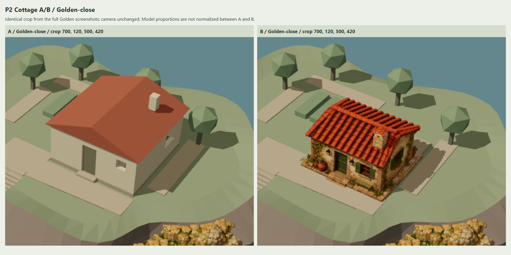

# M2.4 — Tripo Cottage Candidate 01 / P2 Golden A/B

日期：2026-11-05。分支：`codex/m2-4-cottage-tripo-spike`。
检查基线：`34bd21b3b6b8a4bbe9b32b2e20ed7ed0cffcd802`（P0/P1 已提交）。

**状态：P2 独立 A/B 入口、固定机位截图及验证完成，等待人工审核。视觉验收尚未通过。**
用户本轮明确授权继续 P2，并要求完成截图后停止；现阶段不执行 P3 或性能优化。

候选门口已对齐原入口，材质和外表面能够在原场景光照下正常观察。但 Golden 中候选房体比 A 更紧凑，背侧露出原基础、内部楼梯开口和护板，因此不能把成功加载或自动检查通过当作比例/地形连接验收通过。

## 查看入口与复现

在项目根目录运行 `npm run dev`，打开：

- `http://127.0.0.1:5173/?scene=cottage-ab`：默认 A，原程序化小屋。
- `http://127.0.0.1:5173/?scene=cottage-ab&cottage=B&view=golden`：直接查看 B。
- `view=golden/house/front/back/left/right/contact-front/contact-back/top`：九个固定机位。
- 原独立模型查看器仍为 `/?scene=cottage-candidate-01`，普通默认场景仍为 `/`。

页面提供 A/B 下拉切换、固定视角按钮、独立查看器和默认场景链接。切换模型不调整相机。B 首次选择才读取原始 HD；切回 A 恢复原小屋及其阴影，后续 B 复用已加载资源。文件缺失时页面报错并恢复 A。

B 沿用 P0/P1 的单文件只读 Vite dev/preview alias。原文件仍在 `art-source/tripo/inbox/tripo_cottage.glb`，未移动、覆盖或重复导出；纯静态 `dist` 不包含这个本地模型。审核机需要已有原文件和海岸资产。

本轮没有重新运行会覆盖旧截图的 P0/P1 fixture，也没有修改 P0/P1 报告的历史停止点；本报告记录新的 P2 授权及结果。

## A/B 基线与环境保护

A/B 都加载现有 blockout 岛屿和普通 `coastal-assembly` preset：原位置的五个 Tripo 岩体实例、既有 `10k-1k` 资产。没有启用 G02/C2、G03 或 G04 海岸几何实验，没有重新生成岛屿或海岸。

灯光、环境、曝光 1、渲染器与 Golden 相机沿用现有配置。岛屿、地形、海岸、庭院、道路、外楼梯、码头、花园、地下室和 Tripo 岩体在 A/B 中保持相同。运行时核对其几何属性/索引 checksum、材质身份、world matrix 和可见性。

B 仅隐藏 `Roof`、`ExteriorWalls`、`GroundFloor_InteriorWalls`、`GroundFloor_Furniture` 四个原小屋视觉组。保留 `GroundFloor_Structure`（含原楼板及 `Stair_Void_Guard`）、`StairsDown`、`Basement`、`Porch_Threshold`。没有封堵原楼梯开口、隐藏外露护板或移动地形来修饰结果。A 恢复这些视觉组原有状态。

## 对齐参数与坐标

Three.js 右手坐标，+Y 向上，1 unit = 1 m；原小屋与候选门均朝 +Z，背面 -Z。GLB 已为 Y-up，不再进行 Blender Z-up 转轴。原屋脊大致沿 Z，候选屋脊沿 X；当前保留入口朝向，未为匹配屋脊旋转 90°。

缩放、yaw 和平移偏移独立保存在 `public/assets/presets/cottage-candidate-01-p2.json`；候选变换作用于独立外层 group，源顶点、UV、贴图和节点变换保持原样。

| 测量/配置 | XYZ 或数值 |
| --- | --- |
| 原楼板 AABB min / max | [-1, 3.6, -4] / [5, 4, 2] |
| 原占地基准 | 6 × 6 m |
| 原屋顶 AABB min / max | [-1.25, 6.7, -4.25] / [5.25, 8.225, 2.25] |
| 原门底部参考 | [1.800000012, 4, 1.850000024] |
| 源门底部 anchor | [-0.060583381, 0.046458302, 0.293387643] |
| 统一缩放 | 6.121237023429779，额外 multiplier = 1 |
| yaw | 0° |
| 独立平移偏移 | [0, 0.08, 0] m |
| B 外层 group 位置 | [2.170845247, 3.795617720, 0.054104719] |
| B 总 AABB 尺寸 | [6, 4.301939923, 5.424453146] m |
| B AABB min / max | [-0.829154753, 3.795617720, -2.658121854] / [5.170845247, 8.097557643, 2.766331292] |
| B 门底部参考 | [1.800000012, 4.08, 1.850000024] |
| B 门底部相对原门 | [约 0, 0.08, 0] m |

统一缩放取原 6×6 占地与候选完整源 AABB 的 X/Z 比例中较小值。由于底座、台阶、花盆等已合并，完整 footprint 对齐不等于房墙本体同宽。位置以源门底部 anchor 对齐原门 X/Z，再加 8 cm 向上 allowance；该 allowance 是初始接触配置，不代表已完成基础配合。

源门 anchor 来自 P0/P1 `front.png`（1320×811）像素 [615,632]，用其记录相机对原始 POSITION/index 射线拾取门底表面。它是人工选点的几何参考，不是 Tripo 语义门节点，也不是完整可通行门洞验证。

0.5 m XZ 网格在 B 完整 AABB 内取 132 个支撑样本；没有空射线，最大底部基准差 2.245618 m、最大基准嵌入 0.204382 m。最大差出现在原内部楼梯下段（如 X=-0.579155、Z=-0.908122，支撑 Y=1.55），说明原楼梯开口仍存在。该诊断把 AABB 最低 Y 当平面，并含附件/空白格，**不能解释为全屋实际悬空 2.25 m，也不能证明连续接触、无穿插或碰撞通过**。完整样本见 `runtime.json`。

## 固定相机截图

主画布 1600×811，DPR 1。Golden 直接使用现有 coastal preset 的 target、yaw、pitch、distance 和 FOV；其他八个固定机位存于独立 JSON，均为 FOV 35°。`runtime.json.records` 保存每张 A/B 图的 camera position、world matrix、projection matrix 和 aspect，自动验证逐机位完全相同。

Golden-close 是两张 Golden 全景的相同像素裁切 `[700,120,500,420]`（x,y,width,height），保留原相机。对照板只排列/等比显示原图，不对单个模型重新取景、归一化大小或修饰外观。接触近景有意聚焦底座，不能用于完整屋顶检查。

| 审核内容 | A/B 对照板 | 观察 |
| --- | --- | --- |
| Golden 全景 | [comparison-golden.png](comparison-golden.png) | 岛屿构图、楼梯、海岸与码头相同；B 房体更紧凑 |
| Golden-close | [comparison-golden-close.png](comparison-golden-close.png) | 屋脊方向、房体轮廓及细节密度差异明显 |
| 固定小屋近景 | [comparison-house.png](comparison-house.png) | 屋顶、烟囱、前/侧墙和原庭院关系 |
| 正面 | [comparison-front.png](comparison-front.png) | 门、窗、花饰和生成台阶能够观察 |
| 背面 | [comparison-back.png](comparison-back.png) | 背墙存在，原楼板外露；部分被原树遮挡 |
| 左侧 / 右侧 | [comparison-left.png](comparison-left.png)、[comparison-right.png](comparison-right.png) | 山墙、窗及底座；补充背侧遮挡区域 |
| 入口与地形 | [comparison-contact-front.png](comparison-contact-front.png) | 入口保持接向原庭院，低台阶与地面关系可见 |
| 背侧与基础 | [comparison-contact-back.png](comparison-contact-back.png) | 原楼板和护板露出；树保持原样 |
| 占地俯视 | [comparison-top.png](comparison-top.png) | 后侧原楼梯开口和护板明确外露 |



共 32 张 PNG：九机位 A/B 原图 18 张、Golden-close 原始裁切 2 张、对照板 10 张、A/B 查看器 UI 2 张。另有 [B 俯视原图](B-top.png)、[A UI](A-viewer-ui.png)、[B UI](B-viewer-ui.png)。PNG 合计约 8.39 MiB，未包含任何模型副本。

## 验收判断与已知问题

| 用户条件 | 当前判断 |
| --- | --- |
| Golden 中比例自然 | 待人工判断。B 上沿高度接近 A，但合并底座匹配占地后房体更小，屋脊方向也不同 |
| 与地形、楼梯、道路无明显穿插/悬空 | **未通过确认**。门口 X/Z 已对齐；背侧原楼板、楼梯开口、护板暴露，底座与保留楼板局部重叠 |
| 屋顶、门窗、烟囱、背面正确 | 外表面能够观察，未见大块缺失；本轮未做室内/可通行门洞或流形审计 |
| 接近 Golden Reference V1 风格 | 待人工判断。灰泥、橙瓦、绿门窗、花藤方向相近；矩形门、带瓦盖烟囱、浓密旧化纹理有差异 |
| 原 HD 和默认场景未被破坏 | 自动保护及默认回归通过 |
| 开关直接 A/B 对照 | 通过，同机位切换及 A 恢复已验证 |

前侧看起来连接较近，不能抵消背侧基础/楼梯关系未解决的问题。当前模型是单个合并外壳，不能证明原设计的可拆屋顶、室内剖视、地下室楼梯通行能够继续成立。环境仍包含程序化占位美术，不宣称最终艺术质量。

## 验证结果

| 检查 | 结果 |
| --- | --- |
| `npm run build`（含 strict typecheck） | 通过；保留既有公共 chunk >500 kB 提示 |
| `npm run typecheck` / `npm run lint` | 通过，lint 0 warning |
| `npm test` | 11 文件 / 52 项通过 |
| `npm run evidence:cottage:p2` | 1 项综合 fixture 通过，九机位 A/B 证据完整 |
| 既有 M1/M2 浏览器回归 | 11 项通过；新回归证据写入 `test-results`，历史 docs 保留 |
| A 默认 / B 延迟加载 | 通过；初始 A 不请求 HD，首次 B 请求一次 |
| 同相机 / 原环境 / 配置门偏移 | 通过；矩阵、投影、保护对象与入口偏移核对 |
| B→A 像素恢复 | 4 个像素有最大 1/255 通道差，符合 GPU 容差 |
| P2 A 对原普通 coastal-assembly Golden | 0 个像素差 |
| B 直链、resize、缺 B 回退、返回普通默认 | 通过 |
| 原始模型/历史证据保护 | 155 项文件或资产指纹通过；原 GLB SHA 再次核对一致 |
| 主流程 console error / warning / failed request | 0 / 0 / 0（缺文件独立 fixture 另测） |
| P3、性能优化、减面、重烘焙 | 未执行，按用户要求停止在 P2 审图 |

浏览器 Chrome 156.0.8078.79；WebGL2 / ANGLE D3D11 / NVIDIA RTX 3070 Ti。窄屏检查是桌面 viewport resize，不能代表手机实机或 GPU 性能验收。像素比较仅适用于本次同浏览器/驱动环境，不承诺跨 GPU 完全一致。

截图复现（选择空闲端口，避免复用旧 preview）：

```powershell
npm run build
$env:PLAYWRIGHT_BROWSER_PATH = 'C:/Program Files/Google/Chrome/Application/chrome.exe'
$env:PLAYWRIGHT_PORT = '4185'
npm run evidence:cottage:p2
```

该命令更新本 P2 截图及 runtime；缺少本地 cottage 时 fixture 会明确 skip，skip 不能视为通过。详细相机、对齐、支撑样本、像素结果和保护清单见 [runtime.json](runtime.json)。

## 变更与交付停止点

| 路径 | 用途 |
| --- | --- |
| `src/app/CottageComparisonApplication.ts` | 独立 P2 页面、固定机位、A/B、失败回退与资源生命周期 |
| `src/world/cottageComparison.ts` | 独立对齐变换、视觉组开关、原环境保护、支撑诊断 |
| `src/config/cottageComparison.ts` | strict preset 读取及范围/基线约束 |
| `public/assets/presets/cottage-candidate-01-p2.json` | 可回退的缩放/yaw/偏移、固定机位、裁切契约 |
| `src/main.ts` / `package.json` | 新独立路由及 P2 evidence 命令 |
| `tests/browser/cottage-p2.spec.ts` | A/B 证据、相机/环境保护、回退、默认回归 |
| 本 P2 目录 | 报告、runtime 与 32 张 PNG |

原文件 SHA-256：`a7101c0dce3570e9ac6deacf78e0b31ad9a0ac90dbe14501319e9ef93f66b7a4`。提交只含本 P2 代码、轻量 JSON、报告与截图；不提交原 GLB、衍生 GLB 或贴图副本。此前已 staged 的 `docs/research/2026-11-02-diorama-style.md` 排除在本阶段提交之外。

**本阶段单独本地提交后停止，push 由用户操作。等待人工审阅比例、材质方向以及背侧基础/原楼梯开口的兼容性。** 下一步建议是按审核意见决定是否继续独立 P2 修正（例如重新评估房体尺度与保留基础的关系）；涉及基础、楼梯或模型美术改造需另行明确范围。本轮不实施这些调整，不进入 P3，也不替换默认小屋。
