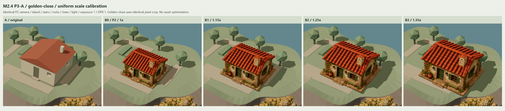

# M2.4 — P3-A 小屋尺度与落位校准

日期：2026-11-06。分支：`codex/m2-4-cottage-tripo-spike`。
基线：`d7fdc35a23e97314572e5e3fe8fa443d4c7f032b`。
本轮按新增的 [P3 handoff](../../../M2_4_P3_COTTAGE_SCALE_PLACEMENT_CODEX_HANDOFF.md) 执行 **P3-A**。这里的 P3 指尺度/落位校准；没有执行原任务中的性能优化阶段。

**结果：A、B0、B1/B2/B3 的可重复对照、实际几何测量与截图完成。工程检查通过，完整落位视觉/空间验收未通过，提交后停止等待人工审核。**

**建议优先审阅 B1（1.15×）的视觉尺度，不能直接批准它替换默认小屋。** B1 比 B0 更饱满，门前仍有约 1.05 m 的保守余宽；B2 约 0.95 m，B3 仅约 0.46 m。四档都与保留的内部楼梯护板有实际顶点穿插；B1–B3 底座跨出原楼板，在较低庭院/地形上方留下约 16–20 cm 的局部间隙。因此本轮没有完全满足“不悬空、不穿插”的候选。

## 入口、保留范围与可回退配置

在项目根运行 `npm run dev`：

- `http://127.0.0.1:5173/?scene=cottage-calibration`：默认 A。
- `http://127.0.0.1:5173/?scene=cottage-calibration&cottage=B1&view=golden`：B1 Golden。
- `cottage=A/B0/B1/B2/B3` 与 `view=golden/front/top/contact-front` 可直接选择。
- 页面下拉切换五档，固定按钮切换四个机位；保留原 P2 `/?scene=cottage-ab` 及 P1 独立入口。

B0 完全保留 P2 的 scale、position、yaw；B1/B2/B3 分别为 B0 的 1.15、1.25、1.35 倍，全部使用统一缩放。没有暗中替换探索倍率或挑掉不合适的候选。

新参数位于 `public/assets/presets/cottage-candidate-01-p3-a.json`。它引用原 P2 preset，不复制或改写相机、灯光、曝光与旧变换。倍率和落位规则无需修改源代码即可复现；配置还保存支撑采样、花床/树冠余距和门前审图目标。

复用 P2 `CottageComparison` 的 A/B 开关、原环境保护与原 HD loader，五档共用同一份源模型几何/贴图；首次选择 B 才读取源 GLB，之后仅切换外层 transform。普通默认场景仍用原小屋。岛屿、地形、海岸、五个 Tripo 岩体、楼梯、码头、树、植被、庭院/平台几何及原 P2/P1 实现与历史截图均保留。B 档只沿用 P2 的四个小屋视觉组隐藏，不封闭原楼梯洞口、不移除护板、不删重叠铺装。

## P2 现状与真实底面

坐标为 Three.js 右手系，+Y 向上，1 world unit = 1 m；门朝 +Z、背面 -Z，yaw=0°。GLB 已为 Y-up，不再进行 Blender Z-up 转轴。候选源模型的尺寸是 Tripo 归一化坐标，需经过世界缩放才解释为米。

| 原始基准 | 数据 |
| --- | --- |
| 原楼板 AABB | min [-1, 3.6, -4]，max [5, 4, 2]；占地 6×6 m，顶面 Y=4 |
| 原屋顶 AABB | min [-1.25, 6.7, -4.25]，max [5.25, 8.225, 2.25] |
| 原外观包围盒（屋顶+楼板+墙体，不含地下室） | 宽/深/高 6.5 / 6.5 / 4.625 m；中心 [2, 5.9125, -1] |
| 原门底参考 | [1.800000012, 4, 1.850000024] |
| B0 scale / position | 6.121237023429779；[2.170845247, 3.795617720, 0.054104719] |
| 源门底 anchor | [-0.060583381, 0.046458302, 0.293387643]；沿用 P2 实际射线拾取点 |
| 源完整 AABB | min [-0.490097016, 0, -0.443084717]；max [0.490097016, 0.702789307, 0.443084717] |
| 源显示/缩放 pivot | 底部中心 [0,0,0]；由原实际 AABB 的 X/Z 中心与最低 Y 得到的独立 group |

遍历实际 POSITION/index，并把各 mesh 的矩阵转换回外层 pivot 坐标。全局最低 Y=0 只涉及两个顶点，不能当作完整平底。最低 1% 源高度带内，筛出 92,006 个向下的底面三角形；以 1e-6 源单位聚合同高水平面，最大面积组的实测 Y 为 **0.0006103810716299325**，面积约 **0.475528308 源单位²**。该面用于稳定的脚平面，不抹平原石底座细节。

底面实际 XZ 范围约 [-0.488845825, -0.443084717] 至 [0.489456147, 0.443084717]；并非把屋顶整体包围盒当成底座。底面三角形投影面积之和约 0.830101141 源单位²，可能含重叠三角形，不能当作拓扑封闭或唯一支承面积。

在实际底面上取 21×21 网格、逐三角形求下包络，425 个网格点有源表面，覆盖 96.37%；不把其余 16 个空白格伪造为平底。随后把这 425 个实际源点变换到各候选世界坐标，向下射线测量原可见楼板、平台、路径、地形、地下室和内楼梯的支撑；采用世界法线筛选向上的支承表面。详见 [runtime.json](runtime.json) 的 `calibration.sourceBase` 与每档 `groundContact.samples`。

B0 的主底面 Y=3.799354，而原楼板顶面 Y=4，实际底点对楼板出现约 20 cm 的嵌入。这是保留的 P2 状态，没有借校准入口改写 B0。

## B1–B3 的独立落位规则

每档首先按原门 X/Z 与实测源门 anchor 对齐，再根据本档完整尺寸求位置：

1. Y = 原楼板顶面 − 实测主底面 Y × 本档 scale；使主底面接触 Y=4 的现有高平台。单个最低顶点比主面略低，分别约 4.3/4.7/5.0 mm，仍保留源几何。
2. X 只向右移动到实际底座左沿与 `Garden_Bed_2` 右沿之间保留 3 cm，以免放大后穿入原花床。各档门 X 会随之变化，明确记录而非宣称原门点完全不动。
3. 若完整模型后侧触及原右后树冠包围盒，再向前移到 5 cm 余距。B1/B2 不需要这一步；B3 为避开树冠另前移约 0.379 m，显著压缩门前通道。

这些规则优先保持已有障碍与高楼板，不能保证整个底座支承：原楼板只有 6×6 m，且有楼梯洞口；B1 的实际底面宽已约 6.887 m、深约 6.238 m，B2/B3 更大。把整屋再下移到庭院 Y≈3.835，会重新穿入 Y=4 的楼板。当前限制来自现有平台高差和楼梯结构，本轮不能通过改它们解决。

## 候选测量表

尺寸顺序为 **宽 / 深 / 高（X/Z/Y）**；位置、中心、偏移顺序为 **X/Y/Z**。Base Y 指实测主底面，不等于孤立最低顶点。

| 档位 | 相对 B0 | 统一 scale | 宽 / 深 / 高 m | group 世界位置 | 世界 AABB 中心 | 主 Base Y |
| --- | --- | --- | --- | --- | --- | --- |
| A | 原程序化 | 原样 | 6.500 / 6.500 / 4.625（外观包围盒） | 原样 | [2, 5.9125, -1] | 楼板顶 4.000 |
| B0 | 1.00× | 6.121237 | 6.000 / 5.424 / 4.302 | [2.170845, 3.795618, 0.054105] | [2.170845, 5.946588, 0.054105] | 3.799354 |
| B1 | 1.15× | 7.039423 | 6.900 / 6.238 / 4.947 | [2.621192, 3.995703, -0.215280] | [2.621192, 6.469319, -0.215280] | 4.000000 |
| B2 | 1.25× | 7.651546 | 7.500 / 6.781 / 5.377 | [2.920426, 3.995330, -0.394869] | [2.920426, 6.684042, -0.394869] | 4.000000 |
| B3 | 1.35× | 8.263670 | 8.100 / 7.323 / 5.808 | [3.219661, 3.994956, -0.195322] | [3.219661, 6.898765, -0.195322] | 4.000000 |

| 档位 | 相对 B0 的 group 偏移 m | 门底世界 XYZ | 门到庭院前沿 m | 底座前沿到庭院前沿 m | 底座/外楼梯 XZ AABB 间距 m |
| --- | --- | --- | --- | --- | --- |
| B0 | [0,0,0] | [1.800000, 4.080000, 1.850000] | 2.129 | 1.213 | 1.677 |
| B1 | [0.450347, 0.200086, -0.269384] | [2.194720, 4.322743, 1.850000] | 2.108 | 1.054 | 1.553 |
| B2 | [0.749581, 0.199712, -0.448974] | [2.456870, 4.350807, 1.850000] | 2.094 | 0.949 | 1.471 |
| B3 | [1.048815, 0.199338, -0.249427] | [2.719019, 4.378872, 2.229136] | 1.701 | 0.464 | 1.076 |

尺寸与位置来自完整实际顶点/矩阵；庭院前沿由真实 `Courtyard` 三角形与门所在 X 线相交求出，避免使用整个庭院更大的 AABB。底座前沿距取实际底座包围盒最大 Z，是这条入口线的保守余宽；外楼梯距是投影包围盒间距下界。它们是计算值，不是人工估计，不代表完整角色路径、转弯宽度、门洞通行或建筑规范通过。1 m 是本轮审图目标，不是用户原要求的硬性规范。

| 档位 | ±1 cm 内接触 / 425 | 有间隙 | 嵌入 >1 cm | 无支撑射线 | 最大底面间隙 m | 最大嵌入 m | 落入原护板内的源顶点 |
| --- | --- | --- | --- | --- | --- | --- | --- |
| B0 | 17 | 68 | 340 | 0 | 2.699 | 0.201020 | 318 |
| B1 | 275 | 150 | 0 | 0 | 2.800 | 0.000430 | 792 |
| B2 | 233 | 192 | 0 | 0 | 2.625 | 0.000467 | 472 |
| B3 | 212 | 212 | 0 | 1 | 2.450 | 0.000505 | 640 |

最大间隙多来自跨过原楼梯洞口或平台边界，不能说整屋悬空 2–3 m。例如 B1 [0.327780, 4.000000, -2.294653] 射线到地下室楼板 Y=1.2。门前庭院点的实际间隙约 **0.1648 m**，旁边低地约 **0.1998 m**，在 contact-front 原图中可见。

护板检测先验证原障碍 mesh 是凸体，再逐个源顶点做世界凸平面包含判断；正值证明有实际穿插。无顶点命中不能穷尽所有面面相交；支撑网格也不是物理承载/流形证书。树/花床与外楼梯未出现候选 3D 包围盒相交。另对五个原 Tripo 岩体读取原 POSITION、套用未改 preset 并核对 SHA；四档与其 3D AABB 均不相交，见 [coastal-spatial-check.json](coastal-spatial-check.json)。该独立读数只生成 JSON，没有保存或改写任何模型。

## 固定视角与截图

所有图保持原 P2 画布 **1600×811 / DPR 1 / 曝光 1 / FOV 35°**，Golden、front、top、contact-front 的 camera world/projection matrices 与 P2 逐项一致。没有为放大的模型移动、缩放或重新拟合相机。

Golden-close 仍是每张 Golden 图同一 `[700,120,500,420]` 像素裁切，不是另一机位。对照板统一排列/等比显示原图；模型没有单独归一化尺寸。contact-front 本来只检查底座，放大档的屋顶超出这个局部机位；完整屋顶与烟囱请看 front、top 和 Golden。

| 图 | 审阅用途 |
| --- | --- |
| [overview.png](overview.png) | 五档 × Golden-close / top / contact-front 紧凑总览 |
| [comparison-golden.png](comparison-golden.png) | 岛屿全景比例、到楼梯/码头的关系 |
| [comparison-golden-close.png](comparison-golden-close.png) | 小屋体量、屋顶与烟囱比例 |
| [comparison-front.png](comparison-front.png) | 门窗、完整屋顶与入口关系 |
| [comparison-top.png](comparison-top.png) | 占地与原花床、平台、楼梯开口、树的关系 |
| [comparison-contact-front.png](comparison-contact-front.png) | 底座、原铺装高差和通道余宽 |



共 **32 张真实浏览器 PNG**：五档 × 四机位原图 20 张、Golden-close 原裁切 5 张、五张全档对照板、一张 overview、一张 [viewer UI](viewer-ui.png)。合计约 **13.98 MiB**。原图如 [B1 正面](B1-front.png)、[B1 接地](B1-contact-front.png)、[B3 俯视](B3-top.png) 可放大检查；没有生成式合成截图或修改模型外观。

## 判断、测试与交付

B1 的屋顶/房体相对 B0 更接近原小屋的场景分量，统一缩放保留了烟囱和瓦片比例，是本轮首选的**尺度审图方向**。B2 进一步占据侧路、门前余宽略低于审图目标；B3 为避树而前移，入口显著变窄，右前底点有一次无支撑射线，不建议选择当前落位。B0 是重现旧状态，不作为接地修正候选。

**四个展示落位均不通过完整空间门槛**，原因是合并底座与固定高/低平台及原楼梯护板的兼容性。本轮没有穷举整岛所有平移，更没有把屋子移到其他区域来规避原入口关系。保留重复铺装和原楼梯结构的问题，供后续另行审阅；不删底座、不改平台、不改地形/树木，也不进入 P3-B。

| 检查 | 结果 |
| --- | --- |
| `npm run build` / strict typecheck | 通过；保留既有公共 Three.js chunk >500 kB 提示 |
| `npm run lint`（最终改动另复查） | 通过，0 warning |
| `npm test` | 11 文件 / 52 项通过 |
| `npm run evidence:cottage:p3-a` | 2 项通过：五档证据/测量与保护；快速切换、404 回退/重试、再次进入 |
| 原 M1/M2 浏览器回归 | 11 项通过；新证据写入 `test-results`，未覆盖历史 docs |
| A/B0 相对 P2 四机位像素 | 每张 0–6 个像素最大 1/255 通道差，符合本机 GPU 容差 |
| 全档切换后恢复 A / B0 | 同次运行均 0 像素差 |
| 相机、原环境、uniform scale、真实底面、独立落位 | 自动验证通过 |
| A 默认不读 HD / B 一次加载 / 直链 B1 / resize / 原默认 | 通过 |
| 源文件与历史保护 | 189 个 tracked 文件指纹通过；原 GLB SHA 前后相同；五个岩体实例源 SHA 另核对 |
| 主证据 console error / warning / failed request | 0 / 0 / 0（404 独立测试另测） |
| 性能优化、模型/贴图改造、默认替换、P3-B | 未执行，范围未授权 |

Chrome **156.0.8078.80**，WebGL2 / ANGLE D3D11 / NVIDIA RTX 3070 Ti。窄屏仅桌面 resize 检查，不代表手机实机性能。跨浏览器/驱动不承诺像素完全一致。

复现命令（项目根，选择空闲 preview 端口）：

```powershell
npm run build
$env:PLAYWRIGHT_BROWSER_PATH = 'C:/Program Files/Google/Chrome/Application/chrome.exe'
$env:PLAYWRIGHT_PORT = '4186'
npm run evidence:cottage:p3-a
```

此 fixture 更新本 P3-A runtime/截图，保留 P2/P1。缺本地原 cottage 时明确 skip，skip 不等于通过。只读原文件仍为 `art-source/tripo/inbox/tripo_cottage.glb`，SHA-256 `a7101c0dce3570e9ac6deacf78e0b31ad9a0ac90dbe14501319e9ef93f66b7a4`；dev/preview alias 沿用 P1，静态 dist 不附带 HD 文件。

变更：`src/app/CottageCalibrationApplication.ts`（独立入口）、`src/world/cottageCalibration.ts`（源底面/落位/接触/障碍测量）、`src/config/cottageCalibration.ts`（strict 配置）、新 P3-A preset、`tests/browser/cottage-p3-a.spec.ts`、`src/main.ts` / `package.json`（路由/命令）及本交付目录。没有提交 GLB/纹理或衍生模型。

**单独提交并尝试 push 后停止；实际提交 SHA 和 push 结果见本轮交付消息。** 等待人工决定 B1 尺度方向是否接受，以及后续是否授权处理底座/原楼梯/铺装兼容性；本报告不构成默认替换或 P3-B 授权。
