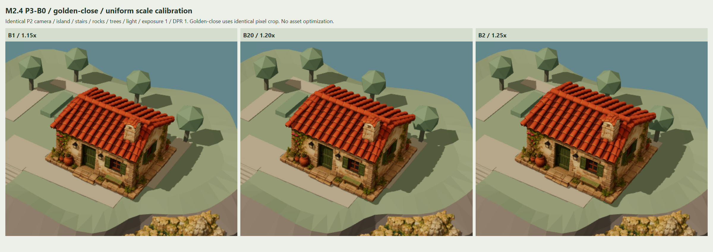
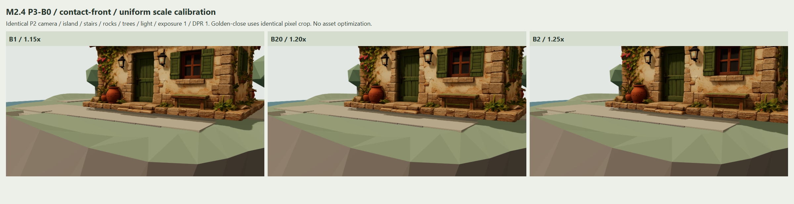

# M2.4 — P3-B0：1.20× 小屋尺度与接地测量

日期：2026-11-06。分支：`codex/m2-4-cottage-tripo-spike`。
执行前基线：`4e5fcaa9055b087dd34de0cff945a4f82f136a33`。
需求：[P3-B handoff](../../M2_4_P3_B_COTTAGE_120_SCALE_CONTACT_CODEX_HANDOFF.md)。前阶段：[P3-A 报告](../P3-A/REPORT.md)。

**P3-B0 工程交付完成：新增 B20（相对 B0/P2 的 1.20×），五类固定视角、真实几何测量和回归验证齐全。尺度视觉等待人工审核；当前落位仍存在局部底座间隙与原楼梯护板穿插，不通过完整接地/空间门槛。提交后停止，未进入 P3-B1。**

## 入口与保留范围

项目根运行 `npm run dev`，打开：

- [P3-B0 默认 A](http://127.0.0.1:5173/?scene=cottage-scale-review)。
- [B20 / Golden](http://127.0.0.1:5173/?scene=cottage-scale-review&cottage=B20&view=golden)。
- `cottage=A/B0/B1/B20/B2/B3`；`view=golden/front/top/contact-front`。
- 原 [P3-A 五档入口](http://127.0.0.1:5173/?scene=cottage-calibration) 和 [P2 A/B](http://127.0.0.1:5173/?scene=cottage-ab) 保留。

新 preset 只引用原 P3-A preset 并增加 `relativeScale: 1.2`；B0=1.00×、B1=1.15×、B2=1.25×、B3=1.35× 的原参数、测量结果和历史图片均未改写。原 P3-A 页面仍显示五档，传入 B20 不会改变旧页面行为。普通默认场景与本入口默认值均为 A，首次选择 B 档才加载 HD。

复用 P2 的原环境、HD loader 与 A/B 可见性规则，B 档仅沿用既有的小屋视觉组切换。原楼板、楼梯洞口、护板、内外楼梯、庭院、路径、地下室、岛屿地形、海岸、码头、树木与 Tripo 岩体保留。原 GLB、UV、材质与纹理未修改，没有新增衍生模型、重拓扑、烘焙或性能优化。

## 同画面对照

三列固定为 **B1 / B20 / B2**，均为实际浏览器渲染。相机 world/projection matrices 与历史 P3-A 逐项一致；历史 P3-A 已核对原 P2 机位。本轮不调整机位或模型的独立画面归一化。

原始画布 **1600×811，DPR=1，曝光=1，FOV=35°**；光照、色彩管理和环境复用原代码与 preset，相关文件指纹不变。Golden-close 是 Golden 原图同一 `[700,120,500,420]` 像素裁切。因此交付五类视图使用四个物理机位，Golden-close 沿用既有裁切契约。

| 固定输出 | 三档同画面对照 | B20 原图 | 用途 |
| --- | --- | --- | --- |
| Golden | [comparison-golden.png](comparison-golden.png) | [B20-golden.png](B20-golden.png) | 岛屿整体比例、楼梯/码头关系 |
| Golden-close | [comparison-golden-close.png](comparison-golden-close.png) | [B20-golden-close.png](B20-golden-close.png) | 体量、屋顶、烟囱与门窗风格 |
| top | [comparison-top.png](comparison-top.png) | [B20-top.png](B20-top.png) | 占地、侧路、花床、原后侧铺装 |
| front | [comparison-front.png](comparison-front.png) | [B20-front.png](B20-front.png) | 完整正面、入口与原路径关系 |
| contact-front | [comparison-contact-front.png](comparison-contact-front.png) | [B20-contact-front.png](B20-contact-front.png) | 底座、高低平台、门前间隙 |



共 **22 张 PNG，12,161,503 bytes（11.60 MiB）**：三档 × 四机位 12 张、三张 Golden-close 裁切、五张对照板、一张 [overview](overview.png)、一张 [viewer UI](viewer-ui.png)。A/B0/B3 在浏览器中逐机位验证并与原 P3-A 图片对照，未重复写入历史证据。局部 contact-front 机位沿用原取景，屋顶可能超出该局部画面；完整结构见 front/top/Golden。

## 实测尺寸与落位

Three.js 右手系，+Y 向上，门朝 +Z，背面 -Z，yaw=0°；1 world unit = 1 m。原 GLB 已为 Y-up，不再次执行 Blender Z-up 转换。下面尺寸按 **宽/深/高（X/Z/Y）**；位置、中心和偏移按 **X/Y/Z**。

沿用 P3-A 对实际 POSITION/index 的测量：最低源 Y=0 仅涉及两个极值顶点；主底面源 Y=`0.0006103810716299325`，该平面面积 `0.47552830799695034` 源单位²；低带含 92,006 个实际底面三角形，21×21 网格中 425 个点有实际源表面。源门 anchor 为 `[-0.06058338099474373, 0.04645830231343734, 0.29338764339938916]`，完整 sourceBase 与 P3-A 深比较一致。

B20 使用原 P3-A 落位规则：主底面放到原楼板 Y=4，底座左沿与原花床留 3 cm；如触及右后树冠才前移。B20 未触发避树前移。X 因花床余距发生变化，门的 Z 仍保持原参考线。

| 候选 | 相对 B0 | 统一 scale | 宽 / 深 / 高 m | group 世界位置 XYZ | 主底面世界 Y |
| --- | --- | --- | --- | --- | --- |
| B1 | 1.15× | 7.039422577 | 6.900 / 6.238 / 4.947 | [2.621192, 3.995703, -0.215280] | 4.000000 |
| B20 | 1.20× | 7.345484428 | 7.200 / 6.509 / 5.162 | [2.770809, 3.995516, -0.305074] | 4.000000 |
| B2 | 1.25× | 7.651546279 | 7.500 / 6.781 / 5.377 | [2.920426, 3.995330, -0.394869] | 4.000000 |

B20 精确统一 scale 为 **7.345484428115734**，position 为 **[2.7708093728796968, 3.9955164553431257, -0.3050743421499269]**。

| B20 几何记录 | 世界测量 |
| --- | --- |
| 相对 B0 的 group 偏移 XYZ | [0.599964126, 0.199898736, -0.359179061] m |
| 完整 AABB min / max | [-0.829190627, 3.995516455, -3.559746230] / [6.370809373, 9.157844364, 2.949597545] |
| 完整 AABB 中心 | [2.770809373, 6.576680409, -0.305074342] |
| 实际源低带 base AABB min / max | [-0.820000024, 3.995516455, -3.559746230] / [6.366101879, 4.047075164, 2.949597545] |
| 门 anchor 世界 XYZ | [2.325795091, 4.336775192, 1.850000024] |
| 相对原门 anchor 的偏移 XYZ | [0.525795079, 0.336775192, 0] m |
| 门所在 X 的庭院实际前沿 | Z=3.951273957 |

| 入口与楼梯检查 | B1 | B20 | B2 |
| --- | --- | --- | --- |
| 门 anchor 到庭院前沿 m | 2.108173 | 2.101274 | 2.094375 |
| 底座前沿到庭院前沿保守余宽 m | 1.054392 | **1.001676** | 0.948961 |
| 底座与外楼梯 XZ AABB 间距下界 m | 1.553006 | **1.511948** | 1.471171 |

庭院前沿由实际 Courtyard 三角形与门所在 X 线相交求出；底座前沿使用实际源低带最大 Z，外楼梯余距为包围盒下界。1 m 是沿用的审图目标，B20 仅多约 **1.7 mm**，不能据此宣布实际角色路径、转弯、门洞或楼梯可通行。

## 原平台实际三角形与底面支撑

本轮增加 `cottageStructure.ts` 的只读诊断。平台面积直接使用原 `GroundFloor_Slab` 的 POSITION/index：筛选原顶面三角形，分别与实测源 base 的 XZ 包络裁切，**楼梯洞口保持原网格空缺**。没有把 6×6 m AABB 伪装成完整平面。

| B20 平台诊断 | 实测结果 |
| --- | --- |
| 原楼板 AABB | min [-1, 3.599999905, -4]，max [5, 4, 2] |
| 原楼板顶面三角形 | 8 |
| 排除实际楼梯洞口后的原顶面面积 | 29.857499968 m² |
| 原顶面落入 B20 base XZ 包络的裁切面积 | 26.488718101 m² |
| B20 base XZ 包络面积 | 46.776807686 m² |
| 425 条实际底面射线中命中原楼板 | 246 |
| 其中与原楼板在 ±1 cm 内接触 | 245 |

**裁切面积表示包络内的原平台几何，不能解释为模型实际接触面积或承重面积。** 真实支撑另外用原 P3-A 的 425 个实际底面样本逐点向下射线检查。

| 底面采样结果（425 点） | B1 | B20 | B2 |
| --- | --- | --- | --- |
| ±1 cm 内接触 | 275 | **252** | 233 |
| 有间隙 | 150 | **173** | 192 |
| 嵌入 >1 cm | 0 | 0 | 0 |
| 无下方支撑命中 | 0 | 0 | 0 |
| 最大样本间隙 m | 2.800000 | 2.625000 | 2.625000 |
| 最大样本嵌入 m | 0.000430 | 0.000449 | 0.000467 |

B20 最大间隙 `2.6249997832411474 m` 出现在跨原楼梯区域的射线上，不能描述为整栋房屋悬空 2.6 m。局部真实问题仍存在：Courtyard 23 点间隙约 **0.164776–0.165000 m**，Right_House_Path 42 点约 **0.139776–0.140000 m**，原地形 50 点约 **0.199776–0.301963 m**。原楼板命中的 246 点中也有一处局部底面高差约 3.38 cm。详细点位、gapM 与 supportNode 见 [runtime.json](runtime.json)。主底面落在 Y=4 并不意味着合并石底座全部得到连续支撑。



## 保留护板与内楼梯穿插

先做世界 AABB 排除；有相交时验证原障碍为凸体，再用原障碍实际面平面检测每个候选 POSITION 顶点。包含容差 `1e-5 m`，正命中证明实际穿入障碍；零命中不能排除所有三角形间相交。

| 原护板诊断 | 结果 |
| --- | --- |
| 原 Stair_Void_Guard AABB | min [1.25, 4, -3.700000048]，max [1.309999943, 5, -0.550000012] |
| B1 / B20 / B2 落入凸体的源顶点数 | 792 / **388** / 472 |
| B20 深于 1 cm 的顶点 | **266** |
| B20 最大顶点包含深度 | **0.029990326 m** |

计数变小不是接地合格或碰撞质量分数；B20 的 388 个正命中已经证明原护板冲突仍存在。

对原 `StairsDown` 下 **16 级台阶 + 1 个中间平台**逐个报告世界 bounds 与检测结果：16 个 AABB 与候选不相交，跳过凸体测量并记录 `convex:null`；最上一级 AABB 相交、验证为凸体，未包含候选顶点。17 个节点的命中数均为 0，**不构成楼梯开口可用、完整面面不相交或导航通过证明**。没有隐藏护板、填楼梯洞口或改平台来掩盖上述问题。

## 验证与交付

| 检查 | 结果 |
| --- | --- |
| `npm run build`，含 strict typecheck | 通过；保留既有公共 Three.js chunk >500 kB 提示 |
| `npm run lint`；最终结构诊断与单测另复查 | 通过，无 lint 报错/警告 |
| `npm test` | **12 文件 / 55 项通过**，原 52 项保留，新增三角形裁切/真实开口面积的 3 项解析测试 |
| `npm run evidence:cottage:p3-b0` | **2 项通过**，最后诊断修正后已重新生成本轮证据 |
| 原 M1/M2 浏览器回归 | **11 项通过**，输出定向至 test-results，未覆盖原 docs |
| 原 B0/B1/B2/B3 全部测量、源底面记录 | 与历史 P3-A 深比较完全一致 |
| 原 A/B0/B1/B2/B3 × 四机位像素对照 | 共 20 张，最多 8 个像素有差，最大通道差 1/255；另验证 A/B0 恢复 |
| 六档 uniform scale、固定相机矩阵、原环境、B20 结构诊断 | 通过 |
| A 不加载 HD、首次 B 加载、直链 B20、resize | 通过 |
| 快速选择、源文件 404 回退到 A、重试、原 P3-A/P2 入口 | 通过 |
| 保护原代码、资产 preset、P0/P1/P2/P3-A 历史证据 | **227 个 tracked 文件指纹核对通过** |
| 主证据 console error / warning / failed request | **0 / 0 / 0**；404 在独立用例中另测 |
| P3-B1、性能优化、默认替换 | 未执行；等待人工审核 |

Chrome **156.0.8078.80**，WebGL2 / ANGLE D3D11 / NVIDIA RTX 3070 Ti。桌面窄屏 resize 通过，未进行手机实机或跨 GPU 性能评估；本轮像素容差是该固定浏览器/后端的证据。

原文件仍在 `art-source/tripo/inbox/tripo_cottage.glb`，**67,361,380 bytes（64.24 MiB），1,907,653 三角面**。读取前后 SHA-256 均为 `a7101c0dce3570e9ac6deacf78e0b31ad9a0ac90dbe14501319e9ef93f66b7a4`。原 HD 仅本地通过既有 alias 读取，未复制或加入 Git；静态 dist 仍不附带该文件。

复现本轮证据（项目根，先 build；此命令只更新 P3-B0 输出）：

```powershell
npm run build
$env:PLAYWRIGHT_BROWSER_PATH = 'C:/Program Files/Google/Chrome/Application/chrome.exe'
$env:PLAYWRIGHT_PORT = '4188'
npm run evidence:cottage:p3-b0
```

缺少本地原 GLB 时用例明确 skip，skip 不等于通过。**保留历史证据时不要重新运行原 P0/P1、P2 或 P3-A 截图生成命令。**

本轮变更文件：

- `src/app/CottageScaleReviewApplication.ts`：新增独立六档固定视角入口。
- `src/config/cottageCalibration.ts`：保留原五档 parser，增加 B20 gate/config。
- `src/world/cottageCalibration.ts`：复用原落位/采样，条件增加 B20 与结构诊断。
- `src/world/cottageStructure.ts`：原平台三角形裁切与原护板/内楼梯顶点包含测量。
- `public/assets/presets/cottage-candidate-01-p3-b0.json`：独立可回退 1.20× 配置。
- `src/main.ts`、`package.json`：新路由与 evidence 命令。
- `tests/browser/cottage-p3-b0.spec.ts`、`tests/unit/cottageStructure.test.ts`：新增阶段验证。
- 本目录 `REPORT.md`、`runtime.json` 与 22 张 PNG。

报告、实现和截图在同一独立提交；精确交付 SHA 和 push 结果在本轮交付消息中记录，也可执行 `git log -1 --format=%H -- docs/m2.4-cottage-tripo/review-gates/P3-B0/REPORT.md` 查询。

**停止点：P3-B0 完成，1.20× 视觉假设待审核；护板穿插与局部连续支撑问题仍未解决。下一阶段仅在人工明确批准后进入 P3-B1 的可切换平台/基础方案提案，本轮未实施该阶段。**
