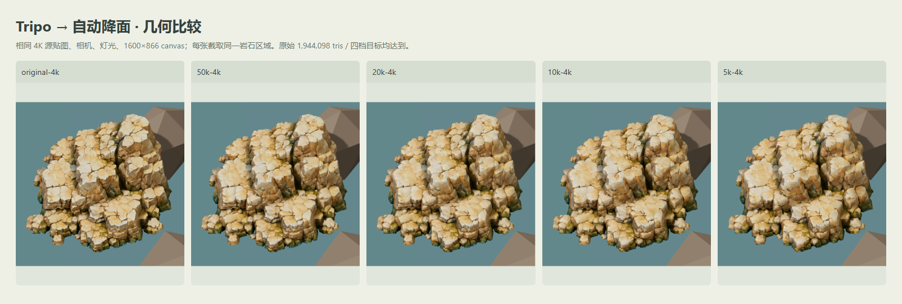
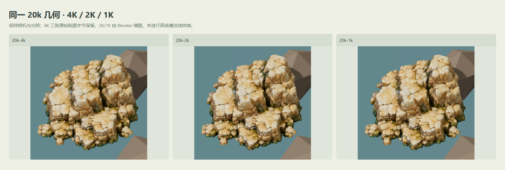
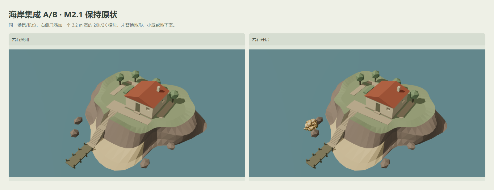
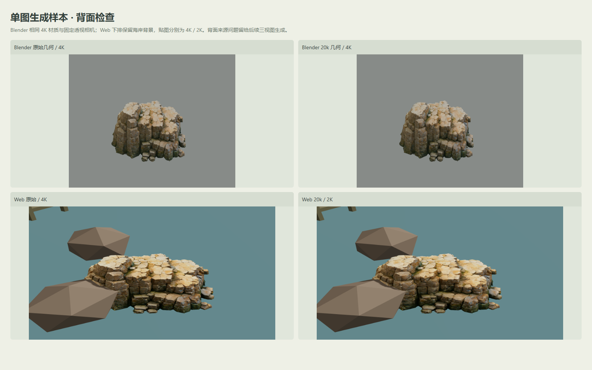

# Tripo 岩石数据来源工作流实验 — 结果

日期：2026-10-29。分支：`codex/tripo-rock-pipeline-spike`。本次重点是验证新来源的可重复工作流，不是批准最终美术。M2.1 V1 资产保持原状，没有合并或替换地形，也没有进一步 Tripo 生成/订阅费用。

## 判断

**建议继续使用 Tripo 作为局部海岸岩石的候选来源；Blender 自动优化链已走通。** 原始单图模型闭合、可渲染，自动生成的四档几何均达到 5k/10k/20k/50k 目标，保持单壳、UV、三张 PBR 贴图和底部中心锚点。普通场景尺度可优先试 **10k/1K**（约 1.85 MiB、贴图估算 16 MiB）；近距离检查保留 **20k/2K**（约 5.09 MiB、贴图估算 64 MiB）。默认实验参照仍为 20k/2K，所有版本都未自动批准。

单图输入使背面趋向较规整的岩石堆叠，不把它归因于优化链；原始/优化背面均保留截图。用户已说明 Tripo 支持指定三视图，本次生成时未使用，背面质量留待后续输入优化。本次不再生成模型。该流程也不证明可以直接用一个 Tripo 模型替代整个岛屿和真实地下室。

## 实际检查

- 输入：`art-source/tripo/inbox/rocky pyramid 3d model.glb`，69,074,820 bytes，1,944,098 三角形；SHA-256 `157e8f4ad758cbf2a0ad5cb333401a9269500f19413068db035703cb2acfa429`。原始文件未改动，运行时原始参照是字节相同的本地副本。
- Blender 5.2.1 LTS；本次优化执行 36.99 s（独立优化过程，含导入/拓扑/缩图/导出，不包括浏览器测试）。完整一键运行耗时另见 `artifacts/tripo-rock/pipeline-run.json`。
- 原始导入合并同位置顶点后 972,047 个顶点，1,944,098 面；边界边 0、非流形边 0、松散点 0、零面积面 0；1 个壳体。所有 LOD 也为闭合单壳。没有可靠统计内部重叠/隐藏面，不声称已剔除它们。
- 源扩展声明 `KHR_materials_volume` / `FB_ngon_encoding` 没有实际材质 payload 或 required 项；本样本导出改用标准 PBR。以后输入如有真正扩展数据，脚本会要求显式转换。
- 几何使用 Blender 渐进 COLLAPSE/QEM：原始→50k→20k→10k→5k。不是手工重拓扑，没有高→低法线烘焙；保留 UV 与原切线空间 normal 图，Web 验证 map/normalMap/roughnessMap/metalnessMap 均存在且颜色空间正确。
- 4K 三张源图 blob 保留不变；2K/1K 经 Blender Image 缩图，base color sRGB，ORM/normal Non-Color。ORM 的 G 粗糙度/B 金属通道和 normal 方向保持。没有升采样、KTX2/BasisU、Draco 或强制解码依赖。
- 坐标使用 glTF Y-up ↔ Blender Z-up 标准转换；导入应用对象矩阵，底部中心锚点、X 宽 3.20 m 后导出。Three.js 独立几何解析验证尺寸/原点，原始参照在加载时按相同规则缩放；放置 [-9.5,-0.04,9.8]，旋转 Y=0°。
- 13 个版本独立 GLB 解析/材质元数据/UV/法线/有限顶点/尺寸/拓扑/哈希检查通过；脚本完整流程重复两次，统计与贴图 hash 比较见 `artifacts/tripo-rock/reproducibility.json`。
- 单个对象规范化到模块尺度，不改小屋/地下室/岛屿文件。基线资产哈希检查见 `artifacts/tripo-rock/baseline-preservation.json`。

## 自动验收与交付文件

一键运行各阶段成功：独立验证 13 个资产、lint、strict typecheck、28 个单元测试、生产 build、14 个浏览器测试，以及 Blender/Web 截图和报告。完整命令耗时见 `pipeline-run.json`。生产 build 有 Three.js 共用 chunk 超过 500 kB 的体积提示；构建仍成功，后续正式发布时再评估拆包。

重复优化的三角形数、文件大小、primitive 元数据和贴图 hash 一致；7/13 个完整 GLB 的字节 hash 一致。验收保证统计可重复，**不保证所有导出文件字节完全一致**；每次生成以当次 manifest 的 SHA-256 为准。

交付文件：`scripts/{inspect_glb.py,optimize_tripo_asset.py,render_tripo.py,run_tripo.mjs,tripo_pipeline.mjs,validate_tripo.mjs,report_tripo.mjs}`；`art-source/tripo/rock_pipeline.json`；`public/assets/manifests/tripo_rock_spike.json`；`src/{app/TripoApplication.ts,config/tripo.ts,world/tripo.ts,main.ts,style.css}`；`tests/{unit/tripo.test.ts,browser/tripo.spec.ts,browser/m2.spec.ts}`；`.gitignore`、`package.json`、`README.md`、本说明及 `artifacts/tripo-rock/*.json` 和 `docs/tripo-rock-spike/images/*.png`。三个 `.gitkeep` 保留本地资产目录。

## 几何、文件与贴图估算

| 版本 | 实际三角形 | GLB MiB | 贴图估算 MiB |
| --- | ---: | ---: | ---: |
| original-4k | 1,944,098 | 65.87 | 256 |
| 50k-4k | 50,000 | 14.82 | 256 |
| 50k-2k | 50,000 | 6.07 | 64 |
| 50k-1k | 50,000 | 3.17 | 16 |
| 20k-4k | 20,000 | 13.84 | 256 |
| 20k-2k | 20,000 | 5.09 | 64 |
| 20k-1k | 20,000 | 2.19 | 16 |
| 10k-4k | 10,000 | 13.50 | 256 |
| 10k-2k | 10,000 | 4.76 | 64 |
| 10k-1k | 10,000 | 1.85 | 16 |
| 5k-4k | 5,000 | 13.32 | 256 |
| 5k-2k | 5,000 | 4.58 | 64 |
| 5k-1k | 5,000 | 1.67 | 16 |

贴图估算假设三张 RGBA8 + 完整 mip 链，4K=256 MiB、2K=64 MiB、1K=16 MiB；不含几何、帧缓冲、岛屿纹理。它是估算，不是浏览器提供的真实 VRAM 占用。缩图仍需加载/解码 JPEG/PNG，本次没有压缩纹理格式。

## 实测运行

Chrome 155.0.8059.85，GPU：ANGLE (NVIDIA, NVIDIA GeForce RTX 3070 Ti (0x00002207) Direct3D11 vs_5_0 ps_5_0, D3D11)。固定机位 front yaw 35°、pitch 42°、distance 8 m、垂直 FOV 35°；侧面 yaw 125°、背面 215°，全景用既有机位。所有候选在同一光照/曝光、视口下截图。基线相机/资产仍能单独访问。

60 帧预热，随后 120 个 RAF 间隔；CPU render 时间只测提交命令，不含 GPU 完成时间。fetch/parse 为本机 localhost 当前请求的响应体/GLTFLoader 时间，不称为真实互联网冷加载。桌面画布 1600×866、DPR=1。三角形/调用数含阴影；近景裁剪会减少岛屿绘制，与全景基线不是同一 draw-call 口径。

| 桌面版本 | fetch ms | parse ms | FPS | 帧 p95 ms | CPU 提交 p95 ms | calls | 渲染 tris |
| --- | ---: | ---: | ---: | ---: | ---: | ---: | ---: |
| original-4k | 114.9 | 162.5 | 60.00 | 16.80 | 0.60 | 124 | 3,892,252 |
| 50k-4k | 52.2 | 145.8 | 60.00 | 16.80 | 0.60 | 124 | 104,056 |
| 50k-2k | 21.1 | 78.7 | 60.00 | 16.80 | 0.90 | 124 | 104,056 |
| 50k-1k | 25.8 | 30.6 | 60.00 | 16.80 | 1.10 | 124 | 104,056 |
| 20k-4k | 72.6 | 180.6 | 60.00 | 16.80 | 0.60 | 124 | 44,056 |
| 20k-2k | 83.9 | 60.7 | 60.00 | 16.80 | 1.00 | 124 | 44,056 |
| 20k-1k | 12.7 | 22.4 | 60.00 | 16.80 | 0.80 | 124 | 44,056 |
| 10k-4k | 75.2 | 176.5 | 60.00 | 16.70 | 0.70 | 124 | 24,056 |
| 10k-2k | 79.7 | 73.6 | 60.00 | 16.80 | 0.90 | 124 | 24,056 |
| 10k-1k | 31.5 | 20.6 | 60.00 | 16.80 | 1.10 | 124 | 24,056 |
| 5k-4k | 39.4 | 176.8 | 60.00 | 16.80 | 0.90 | 124 | 14,056 |
| 5k-2k | 19.5 | 56.4 | 60.00 | 16.80 | 0.70 | 124 | 14,056 |
| 5k-1k | 12.8 | 20.0 | 60.00 | 16.80 | 1.00 | 124 | 14,056 |
| 20k-2k (site, off) | 10.5 | 58.3 | 60.00 | 16.80 | 1.30 | 231 | 5,604 |

移动大小视口：390×844 页面，390×722 canvas，DPR=1；仍是同一桌面 Chrome/GPU，**没有物理手机性能认证**。

| 移动视口版本 | fetch ms | parse ms | FPS | 帧 p95 ms | CPU 提交 p95 ms | calls | 渲染 tris |
| --- | ---: | ---: | ---: | ---: | ---: | ---: | ---: |
| original-4k | 93.5 | 153.0 | 60.00 | 16.80 | 0.90 | 123 | 3,892,023 |
| 50k-2k | 22.2 | 64.5 | 60.00 | 16.80 | 0.60 | 123 | 103,827 |
| 20k-2k | 16.5 | 66.5 | 60.00 | 16.80 | 0.90 | 123 | 43,827 |
| 10k-1k | 8.3 | 21.9 | 60.00 | 16.80 | 1.00 | 123 | 23,827 |
| 5k-1k | 8.3 | 20.8 | 60.00 | 16.80 | 0.90 | 123 | 13,827 |

原始和低模均约 60 FPS，受刷新率限制；没有证据宣称帧率提升或代表手机。可以确定几何/文件/贴图估算下降，以及桌面和移动大小视口加载均无 console error/warning。原始只有一次参照对象，不代表可大量堆叠 194 万面的场景。

## 画面检查与限制

20k 保留裂隙和外轮廓，10k/1K 在模块尺度仍有可读层次；5k 近景有局部折面/深缝变浅，适合作为更远景候选。1K 与 2K 在当前机位差别有限，需更近镜头再决定是否值得提高纹理。没有观察到缺图、明显 UV 裂口或法线反向；不等于法线烘焙验证。单壳闭合也不能排除内部自交。

Tripo 的带纹理岩石与当前诊断白模材质差异明显，风格统一留在正式艺术阶段；本次没有装饰岛屿、生成新岩石或批准最终质量。背面按用户说明保留为单图样本问题，后续三视图输入可复用流程。该脚本目前针对一 mesh / 一 material / 三张嵌入贴图的本样本；多材质/特殊扩展需要明确扩展处理。

## 人工 QA 与停止点

- [x] 当前样本原图/GLB 保留，基础工作流完整自动化。
- [x] 几何目标、UV/PBR/轴/原点检查及桌面/移动大小 Web 加载通过。
- [x] baseline 返回和开关、正侧背及同机位比较已提供。
- [ ] 人工判断 10k/1K 与 20k/2K 的细节取舍。
- [ ] 后续三视图输入再审背面，另行验证其输入契约。
- [ ] 正式美术风格与模块批量预算批准。

停止在数据来源可行性实验；M2.1 基线未合并，M2.2 和批量生成未开始。测试与一键命令见 [TRIPO_ASSET_PIPELINE.md](../TRIPO_ASSET_PIPELINE.md)。原始/生成 GLB、Blender master、纹理缓存不入 Git；脚本、参数、报告和对比截图可提交。
